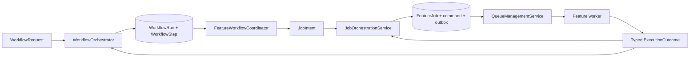

# Review hiện trạng và đề xuất kiến trúc lại — Crawler Worker

> **Trạng thái:** đề xuất, chưa được phê duyệt để triển khai.
> **Quyết định định hướng:** repository này là worker platform thu thập dữ liệu, tách rõ bốn feature: Search, Web Crawl, Image Download và Video Download. Nó không phải HTTP API đa năng.

## 1. Kết quả review hiện trạng

### 1.1 Baseline đã kiểm chứng

| Kiểm tra | Kết quả |
|---|---|
| `uv run pytest` | 176 passed, 16 skipped, 1 cảnh báo deprecation từ `starlette.testclient` |
| `uv run ruff check .` | Pass |
| `uv run ruff format --check .` | 113 files đã đúng format |
| Git working tree | Sạch tại thời điểm review |

16 test bị skip là benchmark, E2E và Docker integration vì Docker Compose stack không chạy. Do đó các luồng tích hợp với PostgreSQL, Redis, MinIO, SearXNG và worker chưa được xác minh trong môi trường thật.

### 1.2 Vấn đề kiến trúc

`app/` đang trộn nhiều bounded context trong cùng một deployable:

- FastAPI routers và request/response API.
- Crawl URL, content normalization, phân loại tài liệu và lưu document.
- Media direct/batch, video discovery, RSS, torrent worker và source registry.
- Search/SearXNG, document library, authorization, backup, alert và release utilities.

Với mục tiêu mới là **crawler worker**, cấu trúc này không còn phù hợp vì:

1. Worker phụ thuộc vào API composition root (`app/api/main.py`) dù nhiệm vụ chính là consume job và thực hiện crawl.
2. Feature crawl, media, torrent và search được phân loại bằng các thư mục kỹ thuật chung (`services/`, `workers/`, `adapters/`), khiến ownership và dependency của từng feature không rõ ràng.
3. Một thay đổi cho crawl phải tìm qua nhiều layer ngang (`services`, `workers`, `adapters`, `api`, `domain`), dễ tạo coupling và khó xóa feature không còn thuộc phạm vi.
4. Video discovery hiện chỉ nhận `raw_items`; browser fallback chỉ đọc fixture; torrent worker không có production client. Các thành phần này không nên quyết định kiến trúc của crawler worker.
5. Documentation đang chuyển từ kiến trúc API/RAG cũ sang worker-first. Active contracts phải nằm trong `docs/INDEX.md`; tài liệu dưới `docs/sample/` chỉ là tham khảo/lịch sử.

### 1.3 Kết luận scope

Repository mục tiêu thực thi các job thu thập dữ liệu sau:

```text
SearchJob       → query provider → chuẩn hóa/deduplicate kết quả → phát SearchResult
WebCrawlJob     → policy → fetch web → trích xuất/phân loại → lưu document → phát CrawlResult
ImageDownloadJob → policy → tải/kiểm tra ảnh → lưu asset/manifest → phát ImageResult
VideoDownloadJob → policy/source/DRM gate → discovery/download được phép → lưu asset → phát VideoResult
```

HTTP API, authentication/authorization cho client, document library UI, RAG/MCP và dashboard không thuộc repository mục tiêu. Các feature worker không gọi nhau trực tiếp: Search chỉ discovery, Web Crawl chỉ thực thi URL đã được chọn; Image và Video có lifecycle/queue/quota riêng.

## 2. Nguyên tắc kiến trúc đích

1. **Worker-first:** entrypoint chỉ consume/acknowledge job; không chứa HTTP controller.
2. **Feature-first:** code được gom theo feature/bounded context, không gom theo loại kỹ thuật toàn cục.
3. **Dependency một chiều:** `domain` không phụ thuộc framework; `application` phụ thuộc domain ports; `infrastructure` cài đặt ports; worker entrypoint chỉ wiring dependency.
4. **Một đường xử lý cho mỗi feature:** Search, Web Crawl, Image và Video đều có application service chính; không tạo pipeline thứ hai cho batch, retry hay input khác.
5. **Policy trước mọi network call:** HTTP và browser adapter phải nhận một policy-approved request; redirect phải được đánh giá lại.
6. **Adapter có thể thay thế:** HTTPX, Playwright/Crawl4AI, PostgreSQL, object storage và queue nằm sau port rõ ràng.
7. **Job contract là ranh giới:** API/service gửi job và crawler worker giao tiếp bằng schema versioned; không dùng ORM model như message contract liên-service.
8. **Không âm thầm xóa dữ liệu/feature:** migration source, queue, database và artifact cần plan rollback độc lập.

### 2.1 Điều phối workflow, job và delivery



- `WorkflowOrchestrator` chỉ chạy workflow đã đăng ký từ request explicit; nó owns `WorkflowRun`, graph, budget/depth và fan-out/fan-in.
- `FeatureWorkflowCoordinator` chỉ mapping input/output cho step của feature; không có state/retry/delivery riêng.
- `JobOrchestrationService` là nguồn sự thật duy nhất cho `FeatureJob`, command durability, idempotency, status/cancel và route.
- `QueueManagementService` là nguồn sự thật delivery: outbox publish, lease, retry, DLQ và acknowledgement.
- Feature worker chỉ execute typed command. Feature không gọi service/queue của feature khác; workflow mới tạo `JobIntent` downstream khi definition cho phép.

## 3. Cấu trúc repository đề xuất

```text
app/
  bootstrap/
    settings.py                 # cấu hình, dependency wiring, lifecycle
    logging.py                  # correlation ID, redaction, telemetry setup

  shared/
    contracts/
      jobs.py                   # versioned input/result/event schemas
    errors/
    observability/

  platform/
    workflow_orchestration/
      domain/
        models.py               # WorkflowRequest, WorkflowRun, WorkflowStep, WorkflowDefinition
      application/
        service.py              # WorkflowOrchestrator: graph, budget, fan-out/fan-in
      infrastructure/
        sqlalchemy_workflow_repository.py

    job_orchestration/
      domain/
        models.py               # JobIntent, FeatureJob, ExecutionOutcome
      application/
        service.py              # JobOrchestrationService: idempotency, status, cancel, route
      infrastructure/
        sqlalchemy_job_repository.py

    queue_management/
      domain/
        models.py               # QueueMessage, JobLease, delivery states
        ports.py                # QueuePublisher, JobLeaseStore, OutboxStore
      application/
        service.py              # QueueManagementService
        retry_policy.py
      infrastructure/
        celery_queue.py         # Celery/Redis transport adapter
        sqlalchemy_lease_store.py
        sqlalchemy_outbox_store.py

    network_policy/
      domain/
        models.py               # PolicyCommand, PolicyDecision
        ports.py                # DnsResolver, RobotsClient, Allowlist
      application/
        service.py              # NetworkPolicyService
      infrastructure/
        dns_resolver.py
        robots_client.py

    asset_storage/
      domain/
        ports.py                # ObjectStorage, AssetRepository
      application/
        service.py              # AssetStorageService
      infrastructure/
        s3_storage.py
        sqlalchemy_asset_repository.py

    document_storage/
      domain/
        ports.py                # ObjectStorage, DocumentRepository
      application/
        service.py              # DocumentStorageService
      infrastructure/
        sqlalchemy_document_repository.py

  features/
    search/
      domain/
        models.py               # SearchJob, SearchResult
        ports.py                # SearchProvider
      application/
        service.py              # SearchService
      infrastructure/
        searxng_provider.py
      worker/
        task.py

    web_crawl/
      domain/
        models.py               # WebCrawlJob, NormalizedDocument
        ports.py                # ContentFetcher, DocumentRepository
      application/
        service.py              # WebCrawlService
        processing_service.py   # normalize + classify
      infrastructure/
        httpx_fetcher.py
        playwright_fetcher.py
        sqlalchemy_document_repository.py
      worker/
        task.py

    image_download/
      domain/
        models.py               # ImageDownloadJob, ImageManifest
        ports.py                # ImageFetcher, ImageValidator
      application/
        service.py              # ImageDownloadService
      infrastructure/
        httpx_image_fetcher.py
        magic_byte_validator.py
      worker/
        task.py

    video_download/
      domain/
        models.py               # VideoDownloadJob, VideoCandidate
        ports.py                # VideoDiscovery, VideoDownloader, DrmDetector
      application/
        service.py              # VideoDownloadService
      infrastructure/
        approved_recipe_discovery.py
        approved_video_downloader.py
        drm_detector.py
      worker/
        task.py

  entrypoints/
    celery_worker.py            # chỉ wiring queues + feature worker tasks

tests/
  unit/features/<feature>/
  integration/features/<feature>/
  e2e/search/
  e2e/web_crawl/
  e2e/image_download/
  e2e/video_download/
```

`platform/queue_management` sở hữu delivery lifecycle: outbox publish, lease, retry scheduling, DLQ và consumer health. Mỗi feature có application service nghiệp vụ duy nhất; sau khi `QueueManagementService` cấp lease hợp lệ, worker task chỉ gọi application service của feature đó và trả execution result cho `JobOrchestrationService` commit trạng thái/publish result outbox trước khi Queue Management acknowledge. Các feature không gọi trực tiếp infrastructure của nhau.

## 4. Feature/service con và trách nhiệm

| Loại | Feature | Application service công khai | Trách nhiệm | Không được làm |
|---|---|---|---|---|
| Platform | `workflow_orchestration` | `WorkflowOrchestrator` | Explicit workflow request, graph, budget/depth, fan-out/fan-in, aggregate result | Tạo FeatureJob trực tiếp, retry delivery hoặc gọi feature service |
| Platform | `job_orchestration` | `JobOrchestrationService` | FeatureJob, idempotency, durable command, status/cancel, queue route | Workflow graph, network call hoặc feature business rule |
| Platform | `queue_management` | `QueueManagementService` | Outbox, lease, retry/DLQ/cancel delivery, queue metrics | Chứa business rule Search/Crawl/Image/Video hoặc diễn giải workflow command |
| Platform | `network_policy` | `NetworkPolicyService` | URL/DNS/IP/redirect/allowlist/quota/robots decision | Thực thi job feature |
| Platform | `asset_storage` | `AssetStorageService` | Object key, metadata, checksum, retention, presigned access qua port | Quyết định source/policy/content type |
| Feature | `search` | `SearchService.execute(job)` | Query provider, normalize/dedupe/rank result; chỉ discovery | Tự tạo WebCrawlJob hoặc gọi fetch URL |
| Feature | `web_crawl` | `WebCrawlService.execute(job)` | Policy → static/browser fetch → extract/normalize/classify → persist document | Download media/video hoặc nhận browser script từ caller |
| Feature | `image_download` | `ImageDownloadService.execute(job)` | Direct URL hoặc page-driven candidate đã chọn: per-item policy, MIME/magic byte, quota, manifest | Parse page HTML, discovery video, tải type khác ảnh, bypass quota |
| Feature | `video_download` | `VideoDownloadService.execute(job)` | Direct URL hoặc page-driven approved recipe, candidate manifest, DRM/entitlement gate, bounded `.mp4`/`.m3u8` | Login/CAPTCHA/paywall/geo-block bypass, tải torrent hoặc caller-provided executable input |

Các service giao tiếp bằng typed command/result trong `domain`, không trao đổi `dict[str, Any]` tự do. Chỉ `infrastructure` được import HTTPX, SQLAlchemy, Boto3, Celery hoặc Playwright.

## 5. Cấu trúc triển khai theo feature

### 5.1 Template bắt buộc cho mọi worker feature

Mỗi feature nằm dưới `app/features/<feature>/` và dùng cùng một ranh giới. Không tạo `app/services/`, `app/workers/` hay `app/adapters/` chung chứa logic của nhiều feature.

```text
app/features/<feature>/
  domain/
    models.py             # Value objects, state, result; không import framework
    ports.py              # Interfaces do feature sở hữu
    errors.py             # Typed business errors/reason codes
  application/
    commands.py           # Typed input nhận từ worker task
    service.py            # Một public use-case: <Feature>Service.execute()
    policies.py           # Business policy nội bộ feature, nếu cần
  infrastructure/
    <adapter>.py          # Cài đặt ports: HTTPX, SQLAlchemy, SDK, process wrapper
  worker/
    task.py               # Nhận job_id, acquire lease, gọi application service
```

`worker/task.py` không chứa business logic, không tự retry và không gọi SDK. Task chỉ: nhận message → dùng `QueueManagementService` acquire lease → load command → gọi `<Feature>Service.execute()` → commit result delivery → acknowledge. Một feature chỉ có **một** `execute()` orchestration path.

### 5.2 Platform dùng chung của worker repository

```text
app/platform/
  queue_management/       # delivery lifecycle, outbox, lease, retry, DLQ
  network_policy/         # SSRF, allowlist, redirect, robots, source/quota decision
  asset_storage/          # object key, asset metadata, checksum, retention
  document_storage/       # document metadata, content hash, Markdown/raw objects
  observability/          # logging, redaction, metrics, trace/audit ports
```

Platform không biết feature-specific parsing hay business behavior. Ví dụ `network_policy` trả `PolicyDecision`, nhưng không crawl URL; `queue_management` giao delivery, nhưng không gọi HTTPX; `asset_storage` lưu bytes/metadata, nhưng không xác định một bytes có phải hình ảnh hợp lệ hay không.

### 5.3 Feature `search`

**Mục đích:** nhận query, gọi search provider đã cấu hình, chuẩn hóa/deduplicate kết quả và phát kết quả bền vững. Search chỉ discovery; không tự enqueue hoặc gọi Web Crawl.

```text
app/features/search/
  domain/
    models.py             # SearchQuery, SearchResult, SearchResultSet
    ports.py              # SearchProvider, SearchResultStore
    errors.py             # InvalidQuery, ProviderUnavailable
  application/
    commands.py           # SearchCommand(query, page, limit, caller context)
    service.py            # SearchService.execute(command)
    normalizer.py         # URL/title/snippet normalize + dedupe + limit
  infrastructure/
    searxng_provider.py   # timeout, response mapping, no raw payload persist
    sqlalchemy_store.py   # result set/query hash retention
  worker/
    task.py               # queue: search.execute.v1
```

**Execution flow:** acquire lease → validate query/quota → `SearchProvider` → normalize/dedupe → persist `SearchResultSet` → outbox `SearchJobCompleted` → acknowledge. Upstream timeout/5xx có thể retry; invalid query/malformed command không retry. URL do search trả về chỉ là result metadata; URL đó chỉ được crawl khi một producer tạo **WebCrawlJob** riêng.

### 5.4 Feature `web_crawl`

**Mục đích:** crawl một URL được chọn, tạo Markdown/metadata/document type có thể truy vết. Đây là feature duy nhất crawl website.

```text
app/features/web_crawl/
  domain/
    models.py             # WebCrawlJob, FetchResult, NormalizedDocument, DocumentType
    ports.py              # ContentFetcher, BrowserFetcher, DocumentProcessor
    errors.py             # FetchTimeout, ContentRejected, ExtractionFailed
  application/
    commands.py           # WebCrawlCommand(url, caller/policy context)
    service.py            # WebCrawlService.execute(command)
    processing_service.py # clean HTML/Markdown, canonical URL, classify, confidence
  infrastructure/
    httpx_fetcher.py      # streaming, byte/type limit, redirect hand-off
    playwright_fetcher.py # reviewed recipe only, sandbox/time/memory limit
    html_processor.py     # DOM/JSON-LD extraction implementation
    sqlalchemy_document_repository.py
  worker/
    task.py               # queue: web-crawl.execute.v1
```

**Execution flow:** acquire lease → `NetworkPolicyService` trước request → static fetch → revalidate mỗi redirect → browser fallback có điều kiện → normalize/extract/classify → `DocumentStorageService` dedupe theo canonical URL/content hash → outbox `WebCrawlJobCompleted` → acknowledge. Browser adapter không nhận JavaScript, selector, cookie hay credential từ job payload.

### 5.5 Feature `image_download`

**Mục đích:** tải ảnh trực tiếp hoặc manifest ảnh được phép; mỗi item có policy, quota, validation và trạng thái riêng. Đây không phải generic media downloader.

```text
app/features/image_download/
  domain/
    models.py             # ImageDownloadJob, ImageItem, ImageManifest, ImageAsset
    ports.py              # ImageFetcher, ImageValidator, ImageManifestParser
    errors.py             # ImageQuotaExceeded, UnsupportedImage, ImageFetchFailed
  application/
    commands.py           # ImageDownloadCommand(urls/manifest, caller context)
    service.py            # ImageDownloadService.execute(command)
    manifest_service.py   # parse, canonicalize, dedupe, sequence
    quota_service.py      # item count, per-item/total bytes, concurrency budget
  infrastructure/
    httpx_image_fetcher.py
    magic_byte_validator.py
    sqlalchemy_image_repository.py
  worker/
    task.py               # queue: image.execute.v1
```

**Execution flow:** acquire lease → parse/dedupe manifest → validate policy cho từng URL trước mạng → stream download với byte limits → validate declared MIME **và** magic bytes → `AssetStorageService` persist checksum/metadata → cập nhật từng `ImageItem` → phát manifest kết quả. Partial failure được giữ ở cấp item; policy/validation failure không retry; transient network/storage error retry theo item/job policy đã định nghĩa.

### 5.6 Feature `video_download`

**Mục đích:** discover và tải video chỉ từ source/recipe đã được review; phát hiện DRM hoặc thiếu quyền thì chặn trước download. Torrent không nằm trong feature này trừ khi có một quyết định product/legal và plan riêng.

```text
app/features/video_download/
  domain/
    models.py             # VideoDownloadJob, ApprovedSource, VideoCandidate, VideoAsset
    ports.py              # SourceRegistry, VideoDiscovery, DrmDetector, VideoDownloader
    errors.py             # SourceNotApproved, DrmDetected, EntitlementDenied
  application/
    commands.py           # VideoDownloadCommand(source URL, caller/policy context)
    service.py            # VideoDownloadService.execute(command)
    source_policy.py      # source state, recipe version, feature quota
  infrastructure/
    source_registry_repository.py
    approved_recipe_discovery.py
    drm_detector.py
    approved_video_downloader.py
    process_sandbox.py    # fixed argv, no shell, time/memory/disk/network limits
  worker/
    task.py               # queue: video.execute.v1
```

**Execution flow:** acquire lease → source registry + `NetworkPolicyService` → chạy fixed reviewed recipe trong sandbox → redact capture → DRM/entitlement gate → download/format adapter được phê duyệt → MIME/checksum/storage → outbox result. Nguồn `pending_review`/`blocked`, DRM, caller selector/JS/credential, CAPTCHA/paywall/geo-block bypass đều dừng không retry.

### 5.7 Dependency matrix

| Feature | Queue | Platform bắt buộc | Result bền vững | Không được gọi |
|---|---|---|---|---|
| Search | `search.execute.v1` | Queue, observability | `SearchResultSet` | Web Crawl/Image/Video service |
| Web Crawl | `web-crawl.execute.v1` | Queue, policy, document storage, observability | `Document` | Image/Video service |
| Image Download | `image.execute.v1` | Queue, policy, asset storage, observability | `ImageManifest` + assets | Search/Web Crawl/Video service |
| Video Download | `video.execute.v1` | Queue, policy/source registry, asset storage, observability | `VideoAsset` + job result | Search/Web Crawl/Image service |

Cross-feature flow chỉ xảy ra qua versioned `WorkflowDefinition` và `JobIntent`. Ví dụ: workflow `search_and_extract` được caller yêu cầu rõ ràng có thể chọn một tập kết quả đã bị chặn bởi budget để tạo `WebCrawlJobRequested v1`; Search worker không được tự publish job đó. Một request `search` độc lập không crawl kết quả.

Image Download và Video Download đều có hai loại workflow đăng ký: **direct URL** (`download_image`, `download_video`) và **page-driven** (`extract_images`, `extract_video`). Page-driven là two-stage: Crawl Data persist `Document` và `ImageCandidateManifest`; Video Download persist `VideoCandidateManifest` qua approved recipe. Workflow Orchestration chọn candidate trong budget rồi tạo download job; các feature không gọi nhau. Result mang `document_reference` và manifest reference. Torrent là capability riêng, deferred, không thuộc Video Download. Chi tiết ở [media candidate workflows](../platform/media-candidate-workflows.md).

## 6. Queue Management

### 6.1 Mô hình delivery

PostgreSQL là **nguồn sự thật** cho trạng thái crawl job và delivery; Redis/Celery chỉ là transport có thể mất hoặc giao lại message. Không đánh dấu một job `completed` chỉ vì Celery đã nhận message.

```text
Producer/API
  → WorkflowOrchestrator (khi workflow request explicit) tạo JobIntent
  → JobOrchestration transaction: tạo FeatureJob + typed command + OutboxEvent(pending)
  → QueueManagement maintenance publisher
  → feature execute queue (Celery/Redis, message chỉ chứa job_id/version/correlation_id)
  → consumer acquire lease nguyên tử trong PostgreSQL
  → FeatureService.execute(leased job)
  → transaction: completed | retry_scheduled | failed | blocked | cancelled
  → CrawlJob result event/outbox
```

Từ đó hệ thống chấp nhận **at-least-once delivery** nhưng đạt hiệu ứng xử lý an toàn nhờ idempotency key, atomic lease và content-hash dedupe. Không tuyên bố exactly-once delivery với Redis/Celery.

### 6.2 Queues được phép trong crawler worker

| Queue | Nội dung | Consumer | Quy tắc |
|---|---|---|---|
| `search.execute.v1` | `SearchJobRequested v1` | Search worker | Rate limit provider, không tạo crawl job |
| `web-crawl.execute.v1` | `WebCrawlJobRequested v1` | Web Crawl worker | `acks_late`, prefetch 1, browser quota riêng |
| `image.execute.v1` | `ImageDownloadJobRequested v1` | Image worker | Per-item/total-byte/concurrency quota riêng |
| `video.execute.v1` | `VideoDownloadJobRequested v1` | Video worker | Approved-source/DRM gate, process/resource quota riêng |
| `worker.maintenance.v1` | Tín hiệu maintenance không nhạy cảm | Maintenance worker | Publish outbox, schedule retry, reclaim lease hết hạn, cleanup theo retention |
| `<feature>.dlq.v1` | Chỉ `job_id`, attempt, reason code, trace ID | Không auto-consume | Dành cho điều tra và requeue có audit/approval |

Không dùng một queue `media` chung vì ảnh và video có policy, quota, CPU/memory profile và lifecycle khác nhau. Torrent không được thêm vào topology này cho đến khi có quyết định product/legal riêng. Một message không mang URL raw, cookie, token, selector hay document body; worker luôn load input đã redaction từ durable store theo `job_id`.

### 6.3 State, lease và acknowledgement

Delivery states đề xuất: `pending_publish` → `queued` → `running` → (`completed` | `retry_scheduled` | `failed` | `blocked_*` | `cancelled` | `dead_lettered`).

- Consumer dùng một `UPDATE ... WHERE` nguyên tử để acquire `JobLease`; không `SELECT` rồi cập nhật ở hai thao tác độc lập.
- Lease có `lease_owner`, `lease_expires_at`, `attempt` và heartbeat/progress rate-limited. Maintenance task chỉ reclaim job hết lease và không ở trạng thái terminal/cancelled.
- Consumer chỉ acknowledge message sau khi durable state đã được commit. `acks_late` và prefetch 1 giảm mất job khi worker chết, nhưng lease vẫn là cơ chế quyết định một job có được thực thi hay không.
- Cancel chuyển job sang `cancellation_requested`; worker kiểm tra tại checkpoint fetch/normalize/persist, dừng an toàn, rồi ghi `cancelled`. Message đến sau cancel được acknowledge mà không crawl.
- Một worker không được retry trực tiếp bằng cách gọi crawl service trong vòng lặp. Mọi retry quay về `retry_scheduled` với `next_run_at`; maintenance scheduler publish lại khi đến hạn.

### 6.4 Retry, DLQ và requeue

`RetryPolicy` dùng error code typed, không phân loại bằng chuỗi exception tự do. Chỉ timeout, lỗi upstream, storage tạm thời hoặc broker delivery failure mới retry với exponential backoff + jitter và giới hạn attempt được cấu hình. Validation, policy, DRM, cancellation và lỗi parse không retry.

Khi vượt `max_attempts`, Queue Management ghi `dead_lettered`, tạo `OutboxEvent` cho `<feature>.dlq.v1`, lưu reason code/audit/trace và không tự chạy lại. Requeue DLQ là command có authorization/approval, tạo delivery attempt mới nhưng giữ liên kết tới dead-letter record để audit.

### 6.5 Outbox, observability và vận hành

- Transaction tạo job cũng tạo `OutboxEvent`; publisher có thể publish lại event chưa xác nhận mà không tạo crawl duplicate.
- Result event dùng outbox riêng; API/producers không polling Redis result backend để suy ra trạng thái nghiệp vụ.
- Metrics tối thiểu: queue depth, age của message/job cũ nhất, publish lag, lease expiry/reclaim count, running count, retry scheduled/exhausted, DLQ count/age, cancellation latency, consumer heartbeat và execution duration/error ratio.
- Alert: queue age vượt SLO, lease expiry tăng, DLQ tăng, publisher lag, worker heartbeat mất hoặc retry ratio bất thường. Mỗi alert phải có runbook/requeue procedure không làm mất audit.

### 6.6 Test plan cho Queue Management

- Unit: state transition hợp lệ, retry matrix theo typed error code, backoff/jitter bounds, cancelled job không acquire lease.
- Persistence/integration: concurrent consumer chỉ một bên acquire lease; outbox publish at-least-once; lease expiry được reclaim; completed job không chạy lại.
- Worker integration: crash sau fetch/trước commit, crash sau commit/trước ack, broker redelivery, retry schedule, DLQ và authorized requeue.
- Observability: message/log/audit không có URL query/token/cookie; queue metrics/alerts có chính xác labels an toàn.
- E2E: Redis + PostgreSQL thật, controlled crawl fixture, consumer scale-up/down và rollback bằng dừng consumer mà không mất job.

## 6. Contract tối thiểu với hệ thống bên ngoài

### Feature job input

```text
<Feature>JobRequested v1
- job_id
- feature_code (search | web_crawl | image_download | video_download)
- correlation_id
- caller_id
- idempotency_key
- policy_context (không chứa secret)
- submitted_at
```

Payload chi tiết nằm trong durable job record theo `feature_code`: `query` (Search), `requested_url` (Web Crawl), image URL/manifest (Image), hoặc approved video URL/source reference (Video).

### Feature job result

```text
<Feature>JobCompleted v1 | <Feature>JobFailed v1 | <Feature>JobBlocked v1
- job_id
- feature_code
- status
- reason_code (đã redaction)
- result_reference (document ID, result set ID hoặc asset manifest ID)
- metrics summary
- completed_at
```

Hệ thống API/producers chịu trách nhiệm authenticate caller, validate payload và publish request. Worker vẫn thực hiện Policy Gate ngay trước từng network call; producer approval không thay thế kiểm tra SSRF/redirect của worker.

## 7. Phạm vi loại bỏ hoặc chuyển đi

| Thành phần hiện tại | Quyết định đề xuất |
|---|---|
| `app/api/` | Chuyển sang API repository/service; worker không chạy FastAPI. |
| `app/services/search_service.py` | Di chuyển thành `features/search`; router chuyển sang API repository. |
| `app/services/crawl_*.py`, normalizer/classifier/persistence, crawl task | Di chuyển thành `features/web_crawl` và shared platform phù hợp. |
| `app/services/media*.py`, `app/workers/media_tasks.py` | Tách thành `features/image_download` hoặc `features/video_download`, không giữ generic media service. |
| `app/services/video_discovery.py`, RSS, source registry cho media | `video_download` sở hữu discovery; source registry/policy shared platform nếu còn cần. RSS chỉ giữ nếu là input video được phê duyệt. |
| `app/workers/torrent_worker.py` | Ngoài bốn feature hiện tại; deprecate hoặc chuyển worker riêng sau quyết định product/legal. |
| `document_library`, authorization HTTP layer | Thuộc API/document service; worker chỉ thực thi ownership/policy context trong job contract khi cần. |

Không xóa các tệp này trong một commit refactor. Mỗi nhóm cần inventory callers, migration của queue/database, feature flag tắt trước và kế hoạch rollback.

## 8. Lộ trình chuyển đổi an toàn

### Phase A — Chốt contract và phạm vi

1. Phê duyệt contracts Search/WebCrawl/ImageDownload/VideoDownload version 1.
2. Chốt owner của API, queue, jobs table, outbox, documents table và object storage.
3. Quyết định browser production adapter: Playwright hay Crawl4AI; định nghĩa sandbox, egress, timeout và memory limit.
4. Đánh dấu API runtime, generic media, torrent, RSS và RAG/MCP là “moved” hoặc “deprecated”; giữ Search, Web Crawl, Image và Video là feature worker chính thức.

### Phase B — Dựng vertical slice crawl song song

1. Tạo platform `queue_management`, `network_policy`, `asset_storage`, `document_storage`; tạo features `search`, `web_crawl`, `image_download`, `video_download`.
2. Viết test contract và unit test Red cho từng service interface trước implementation.
3. Thêm migration additive cho outbox, lease, `next_run_at`, attempt, delivery/audit fields và index queue scheduler; không drop bảng cũ.
4. Đưa từng pipeline hiện có vào feature tương ứng, giữ behavior hiện tại; không chuyển cả bốn feature trong một commit.
5. Chạy mỗi worker mới dưới queue/version/feature flag riêng, không tắt worker cũ ngay.

### Phase C — Kiểm chứng môi trường thật

1. Khôi phục Docker Compose hoặc cung cấp image registry/local cache được phê duyệt.
2. Chạy PostgreSQL/Redis/MinIO integration, controlled-site E2E và crawl browser fixture.
3. Đo queue delay, crawl duration, browser memory, storage growth và error ratio.
4. Hoàn thành backup/restore drill PostgreSQL + MinIO và security sign-off.

### Phase D — Cutover và thu hẹp repository

1. Chuyển producer sang publish crawl contract v1 cho worker mới.
2. Quan sát metrics/audit; rollback bằng consumer/feature flag, không xóa job/document/audit.
3. Sau thời gian ổn định đã định nghĩa, chuyển các feature ngoài scope ra repository khác hoặc xóa theo migration plan đã duyệt.
4. Cập nhật README, runbook, changelog, ownership và release sign-off bằng bằng chứng chạy thật.

## 9. Rủi ro và quyết định cần Q chốt

| Chủ đề | Rủi ro | Quyết định cần chốt |
|---|---|---|
| Queue contract | Mất hoặc xử lý trùng job khi chuyển consumer | Giữ Redis/Celery hay thay broker; at-least-once, outbox/lease schema, retry/DLQ/requeue authorization |
| Feature boundary | Search auto-crawl hoặc Image/Video dùng chung quota/policy sai | Tách job contract, queue, service interface, quota và acceptance test theo feature |
| Dữ liệu hiện hữu | Xóa/đổi schema làm mất document/job/audit | Giữ database dùng chung hay tách database; retention và rollback |
| Browser runtime | SSRF, credential leakage, memory/process escape | Playwright hoặc Crawl4AI, image pinning, sandbox/egress limit |
| API tách khỏi worker | Breaking change với clients hiện tại | API repository owner và thời điểm deprecate endpoint |
| Feature media/torrent | Rủi ro pháp lý và security, feature nửa hoàn chỉnh | Chuyển sang worker riêng hay deprecate hoàn toàn |
| Release readiness | Unit pass nhưng integration/E2E chưa từng chạy | Cách cung cấp Docker images và owner của drill/sign-off |

## 10. Documentation backlog

1. Duy trì `docs/INDEX.md` làm entrypoint cho active worker contracts; chỉ giữ architecture/implementation lịch sử trong `docs/sample/`.
2. Viết lại `README.md` cho crawler worker: scope, run command, contract, cấu hình, local stack và non-goals.
3. Cập nhật CI: phân tách unit/integration/E2E; thêm dependency scan và secret scan.
4. Chỉ ký `docs/release-signoff.md` sau khi có link bằng chứng kiểm thử/drill thực tế.

## 11. Definition of Done cho kiến trúc mới

- [ ] Repository không còn FastAPI runtime; runtime chỉ gồm platform và bốn worker feature đã định nghĩa.
- [ ] Search, Web Crawl, Image Download và Video Download đều có domain ports, application service và infrastructure adapter riêng.
- [ ] Search không auto-crawl; Image và Video có queue/quota/policy riêng; torrent không có trong scope nếu chưa phê duyệt.
- [ ] `QueueManagementService` quản lý outbox, atomic lease, retry scheduler, DLQ và cancellation delivery.
- [ ] Message chỉ chứa contract version, `job_id` và correlation metadata; PostgreSQL là nguồn trạng thái bền vững.
- [ ] Crash/redelivery/reclaim/DLQ/requeue được kiểm chứng với Redis + PostgreSQL thật.
- [ ] Chỉ `WebCrawlService` điều phối crawl end-to-end bên trong Web Crawl feature.
- [ ] Không adapter nào gọi mạng trước `NetworkPolicyService`; redirect được revalidate.
- [ ] Contracts versioned được test bởi producer và worker.
- [ ] Unit, integration và controlled E2E chạy không bị skip trong môi trường được hỗ trợ.
- [ ] Browser adapter thật có sandbox/resource/egress controls và không nhận executable input từ caller.
- [ ] Cutover/rollback được diễn tập; dữ liệu/audit không mất.
