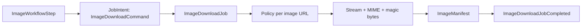

# Feature: Image Download Worker

## Current repository

`MediaJob` accepts direct and batch image URLs, applies policy and quota, downloads with an injected downloader, validates declared MIME and magic bytes, and persists assets. The name is generic but the capability is image-only.

## Target architecture

Two registered workflows exist: direct `download_image` for one allowed image URL or a bounded explicit manifest, and page `extract_images` for a page URL. Crawl Data owns `ImageCandidateManifest` and static image parsing; Image Download never parses page HTML or discovers candidates itself. Workflow Orchestration selects within budget, then Image Download executes and returns `ImageManifest` with per-item outcome.

## After MVP

Browser lazy-load and automatic page expansion are excluded. v1.1 handles only static page evidence.

## Responsibility

Image Download worker tải một ảnh trực tiếp hoặc manifest ảnh được phép. Nó quản lý trạng thái theo từng item, deduplication, quota và image validation; không là generic media downloader.

## Workflow role and data

`extract_images` is deferred to v1.1. When explicitly requested, Crawl Data first persists the page `Document` and an `ImageCandidateManifest` from approved **static** image evidence; Workflow Orchestration enforces the workflow item budget and submits one bounded Image Download child job. Browser lazy-load and automatic page expansion are not part of this version.

| Object | Owner | Purpose |
|---|---|---|
| `ImageWorkflowStep` | Workflow Orchestration | Holds approved static candidates or an explicit image URL/manifest reference. |
| `ImageDownloadCommand` | Image feature | Typed ordered candidate list, quota and redacted policy context. |
| `ImageDownloadJob` | Job Orchestration | Durable `FeatureJob` for one direct image or bounded batch. |
| `ImageItem` | Image feature | Per-item canonical URL, validation and terminal outcome. |
| `ImageManifest` | Image feature | Aggregate of completed, failed and blocked items. |
| `ImageDownloadJobCompleted` | Image feature | Typed outcome with `image_manifest_id`. |



The feature never discovers browser content, does not enqueue Web Crawl/Video jobs, and retains successful items when another item reaches a terminal outcome.

## Target package structure

```text
app/features/image_download/
  domain/
    models.py       # ImageDownloadJob, ImageItem, ImageManifest, ImageAsset
    ports.py        # ImageFetcher, ImageValidator, ManifestParser
    errors.py       # ImageQuotaExceeded, UnsupportedImage, ImageFetchFailed
  application/
    commands.py     # ImageDownloadCommand
    service.py      # ImageDownloadService.execute(command)
    manifest.py     # parse, canonicalize, dedupe, sequence
    quota.py        # per-item, total-byte, item-count/concurrency limits
  infrastructure/
    httpx_image_fetcher.py
    magic_byte_validator.py
    sqlalchemy_image_repository.py
  worker/
    task.py
```

## Queue and contract

- Queue: `image.execute.v1`
- Input: `ImageDownloadJobRequested v1`; durable record holds URL or manifest and caller/policy context.
- Output: `ImageDownloadJobCompleted v1` with `image_manifest_id`; each item is completed, failed or blocked with safe reason code.

## Related contract

- [Media candidate workflows](../platform/media-candidate-workflows.md) defines direct-vs-page workflow, candidate ownership and durable manifest rules.

## Execution

1. Acquire lease and parse manifest into ordered, canonicalized unique items.
2. Check Network Policy for each item URL before any request.
3. Stream under per-item and total-byte limits.
4. Validate declared MIME type and magic bytes before persistence.
5. Persist checksum/size/MIME/object metadata through `AssetStorageService`.
6. Commit each item outcome and final manifest result through outbox.

Partial item failure must not remove successful items. Policy, quota and invalid-image outcomes do not retry; temporary network/storage errors use Queue Management retry policy. Image worker never runs video discovery/download or Web Crawl.

## Tests

Unit-test manifest parse/dedupe/quota and MIME/magic-byte validation. Integration-test streaming limits, partial failure, duplicate checksum, storage error and cancellation. E2E uses controlled image fixtures only.
