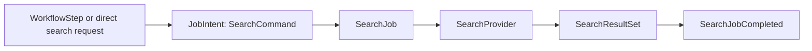

# Feature: Search Worker

## Current repository

`SearchService` calls SearXNG through the configured provider URL, normalizes and deduplicates results, and the transitional FastAPI API may explicitly call crawl for a result the caller selected. Search itself is discovery-only today.

## Target architecture

Search never crawls, discovers media or creates another feature job. For an explicit `search_and_extract`, only Workflow Orchestration applies the registered bounded selection rule and creates separate Crawl Data job intents.

## After MVP

Mini Search is a future standalone target, not a current module. It replaces SearXNG only after matching the normalized result, timeout/error and discovery-only contract, with rollback to SearXNG available.

## Responsibility

Search worker nhận query, gọi provider đã cấu hình, chuẩn hóa/deduplicate kết quả và lưu `SearchResultSet`. Nó là discovery feature: **không tự crawl bất kỳ URL nào**.

## Workflow role and data

| Object | Owner | Purpose |
|---|---|---|
| `SearchWorkflowStep` | Workflow Orchestration | Carries an explicit `search` or `search_and_extract` step input. |
| `SearchCommand` | Search feature | Typed query, page/limit and redacted caller/quota context. |
| `SearchJob` | Job Orchestration | Durable `FeatureJob` for one provider discovery execution. |
| `SearchResultSet` | Search feature | Normalized, deduplicated durable result set. |
| `SearchJobCompleted` | Search feature | Typed outcome with `search_result_set_id`. |



For `search`, the workflow ends at `SearchResultSet`. For explicit `search_and_extract`, Workflow Orchestration—not `SearchService`—applies the registered bounded selection rule and submits separate Web Crawl `JobIntent`s. Search service never creates a crawl job or calls Web Crawl.

## Target package structure

```text
app/features/search/
  domain/
    models.py       # SearchJob, SearchQuery, SearchResult, SearchResultSet
    ports.py        # SearchProvider, SearchResultStore
    errors.py       # InvalidQuery, ProviderUnavailable
  application/
    commands.py     # SearchCommand
    service.py      # SearchService.execute(command)
    normalizer.py   # normalize, dedupe, limit
  infrastructure/
    searxng_provider.py
    sqlalchemy_store.py
  worker/
    task.py
```

## Queue and contract

- Queue: `search.execute.v1`
- Input: `SearchJobRequested v1` with job ID, caller context, query/page/limit in durable record.
- Output: `SearchJobCompleted v1` with `search_result_set_id`; safe title/URL/snippet only.

## Execution

1. Queue Management acquires a lease.
2. `SearchService` validates query/page/limit and provider quota.
3. `SearchProvider` calls configured provider with timeout.
4. `normalizer` removes malformed/duplicate results and limits output.
5. Result set/query hash is persisted and a completion outbox event is committed.

Timeout/upstream 5xx may retry. Invalid query, malformed command and policy block do not retry. A producer may create a separate `WebCrawlJobRequested v1` from a selected result; this worker never does so.

## Related contract

- [Media candidate workflows](../platform/media-candidate-workflows.md) defines why Search results are never media candidates or download jobs by themselves.

## Tests

Unit-test validation, normalization/deduplication and retry classification. Integration-test provider JSON, timeout, rate limit and malformed payload. E2E-test that a Search job never emits a Web Crawl job.
