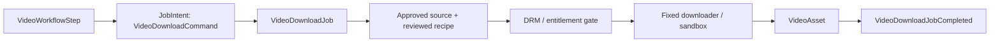

# Feature: Video Download Worker

## Current repository

`VideoDiscoveryService` checks that a source is approved and normalizes supplied `raw_items`; it does not fetch or download video and does not call the network. `torrent_worker.py` is a separate worker and is not part of this feature.

## Target architecture

Two registered workflows exist: direct `download_video` for one approved-source video URL/reference, and page `extract_video` for an approved page/source. When the input is a page URL, Crawl Data persists the page `Document` first and the result carries `document_reference`. Video Download owns `VideoCandidateManifest`, the approved-source registry, recipe version and DRM/entitlement decision; Crawl Data never selects video candidates. `.mp4` is a bounded stream. `.m3u8` is a playlist parsed only for an approved source, with policy-checked bounded segments; encrypted/DRM/unsupported playlists are terminal.

## After MVP

Torrent download is a separate deferred capability. A discovered `.torrent` or magnet may be recorded as a safe candidate reference, but Video Download never downloads it.

## Responsibility

Video Download worker chỉ xử lý video từ source đã được review/approved. Nó dùng fixed server-side discovery recipe, kiểm tra entitlement/DRM và chạy downloader/format adapter bị sandbox. Torrent không thuộc feature này.

## Workflow role and data

`extract_video` is deferred to v1.2. An explicit workflow request may use a registered, approved-source recipe to wait or click Play and capture allowed media evidence before creating a bounded Video Download job. Request content cannot provide a selector, JavaScript, cookie or credential.

| Object | Owner | Purpose |
|---|---|---|
| `VideoWorkflowStep` | Workflow Orchestration | Holds approved source/page reference and workflow budget. |
| `VideoDownloadCommand` | Video feature | Typed source URL/reference, approved-source context and redacted caller/policy context. |
| `VideoDownloadJob` | Job Orchestration | Durable `FeatureJob` for one approved source/download request. |
| `ApprovedSource` | Video feature | Reviewed source state, recipe version and quota policy. |
| `VideoCandidate` | Video feature | Discovered candidate with redacted evidence; never a raw credential/capture store. |
| `VideoAsset` | Video feature | Persisted validated asset reference. |
| `VideoDownloadJobCompleted` | Video feature | Typed success, terminal blocked or failure outcome. |



DRM, entitlement and policy outcomes terminate the step and are never retried or bypassed. Video worker never creates Search, Web Crawl or Image jobs.

## Target package structure

```text
app/features/video_download/
  domain/
    models.py       # VideoDownloadJob, ApprovedSource, VideoCandidate, VideoAsset
    ports.py        # SourceRegistry, VideoDiscovery, DrmDetector, VideoDownloader
    errors.py       # SourceNotApproved, DrmDetected, EntitlementDenied
  application/
    commands.py     # VideoDownloadCommand
    service.py      # VideoDownloadService.execute(command)
    source_policy.py# source state, recipe version and quota
  infrastructure/
    source_registry_repository.py
    approved_recipe_discovery.py
    drm_detector.py
    approved_video_downloader.py
    process_sandbox.py
  worker/
    task.py
```

## Queue and contract

- Queue: `video.execute.v1`
- Input: `VideoDownloadJobRequested v1`; durable record holds source URL/reference, caller context and approved source context.
- Output: `VideoDownloadJobCompleted v1` with video asset reference, or terminal `blocked_policy`, `blocked_permission` or `blocked_drm` result.

## Execution

1. Acquire lease and check source registry, Network Policy and feature quota.
2. Run only the versioned recipe configured for that approved source in an isolated browser/process context.
3. Redact network capture; do not persist cookies, authorization headers or signed URLs.
4. Detect DRM/EME/ContentProtection and entitlement failure before download.
5. Run approved downloader/format process with fixed argv and time/memory/disk/network limits.
6. Validate asset metadata, persist via `AssetStorageService`, commit outbox result and acknowledge.

No login, CAPTCHA solving, paywall/geo-block bypass, user-supplied selector/JavaScript/credential or shell argument is permitted. Source/policy/DRM errors are terminal and never retried.

## Related contract

- [Media candidate workflows](../platform/media-candidate-workflows.md) defines direct-vs-page workflow, video candidate ownership, `.mp4`/`.m3u8` handling and the torrent boundary.

## Tests

Unit-test source state, recipe validation, DRM/entitlement decisions and retry classification. Integration-test approved fixture, sandbox timeout, redaction, downloader failure and cancellation. E2E uses controlled, licensed video only.
