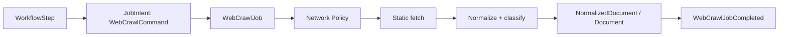

# Feature: Web Crawl Worker

## Current repository

The shipped path is Policy Gate → job → static fetch → normalize → classify → persist a document. It does not expose a durable media-candidate workflow yet.

## Target architecture

Web Crawl returns one `Document` with canonical URL, clean HTML/Markdown, content hash, one `document_type`, confidence/reason and `needs_review`. An explicit `extract_images` workflow may additionally retain an `ImageCandidateManifest` owned by Crawl Data. Classification never creates download jobs, and `media_page` is only a classification label.

## After MVP

`crawl_collection` with bounded depth 2–3, reviewed browser recipes and child-link following are deferred. Each of them must create separate bounded steps through Workflow Orchestration.

## Responsibility

Web Crawl worker là feature duy nhất fetch website. Nó chuyển một URL đã được chọn thành document có canonical URL, clean HTML/Markdown, metadata, document type, confidence và reason.

## Workflow role and data

| Object | Owner | Purpose |
|---|---|---|
| `WebCrawlWorkflowStep` | Workflow Orchestration | Carries the requested URL from `crawl_url` or a bounded `search_and_extract` selection. |
| `WebCrawlCommand` | Web Crawl feature | Typed requested URL and redacted caller/policy context. |
| `WebCrawlJob` | Job Orchestration | Durable `FeatureJob` for one requested URL. |
| `NormalizedDocument` | Web Crawl feature | Canonical URL, cleaned HTML/Markdown, metadata, classification/confidence/reason and content hash. |
| `ImageCandidateManifest` | Crawl Data (Web Crawl feature) | Durable static image evidence for the explicit `extract_images` workflow; Image Download never parses page HTML. |
| `WebCrawlJobCompleted` | Web Crawl feature | Typed outcome with document reference. |



MVP `crawl_url` and `search_and_extract` use one requested URL per job and static processing. `crawl_collection` with bounded depth 2–3 is deferred to v2; it must create separate bounded steps through Workflow Orchestration rather than recurse inside this worker.

## Target package structure

```text
app/features/web_crawl/
  domain/
    models.py       # WebCrawlJob, FetchResult, NormalizedDocument, DocumentType
    ports.py        # ContentFetcher, BrowserFetcher, DocumentProcessor
    errors.py       # FetchTimeout, ContentRejected, ExtractionFailed
  application/
    commands.py     # WebCrawlCommand
    service.py      # WebCrawlService.execute(command)
    processing.py   # normalize, extract, classify
  infrastructure/
    httpx_fetcher.py
    playwright_fetcher.py
    html_processor.py
    sqlalchemy_document_repository.py
  worker/
    task.py
```

## Queue and contract

- Queue: `web-crawl.execute.v1`
- Input: `WebCrawlJobRequested v1`; durable record holds requested URL and redacted caller/policy context.
- Output: `WebCrawlJobCompleted v1` with document reference, or a typed failed/blocked result.

## Execution

1. Acquire queue lease; skip terminal/cancelled job.
2. `NetworkPolicyService` gates initial URL.
3. Static HTTP fetch streams bytes under timeout/type/size limit; every redirect is policy-revalidated.
4. Browser fallback runs only when static content is insufficient and a reviewed server-side recipe permits it.
5. Processing extracts clean HTML/Markdown, canonical URL and one document classification with confidence/reason.
6. `DocumentStorageService` deduplicates by canonical URL/content hash and persists result.
7. Commit outbox result, then acknowledge delivery.

The job payload cannot contain browser JavaScript, selectors, cookies or credentials. Web Crawl does not create Image or Video jobs from discovered links.

## Related contract

- [Document Type Classification](../document-classification.md) defines the taxonomy, signals, metadata and acceptance criteria used by processing.
- [Media candidate workflows](../platform/media-candidate-workflows.md) defines the two-stage page workflow and why Crawl Data never downloads candidates.

## Tests

Unit-test URL/content normalization, classification and state/error mapping. Integration-test streaming, oversize, bad type, redirect/private-IP and storage failure. Controlled E2E covers static, browser fallback, cancellation and document deduplication.
