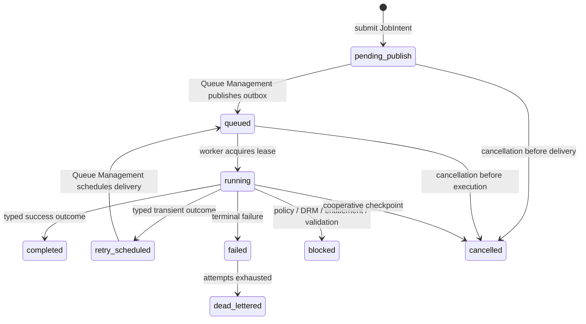
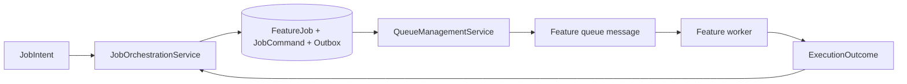

# Job Orchestration

## Scope

`job_orchestration` là control plane duy nhất của một `FeatureJob`. Nó nhận `JobIntent` từ Workflow Orchestration hoặc producer được phép, kiểm tra idempotency, lưu command bền vững, tạo job/outbox atomically, trả trạng thái và nhận cancellation request.

Nó **không** lập kế hoạch workflow, không gọi feature service, không gọi network và không publish trực tiếp tới broker. `queue_management` sở hữu delivery sau khi outbox event đã được commit.

## Objects

| Object | Owner | Nội dung tối thiểu |
|---|---|---|
| `JobIntent` | Workflow Orchestration hoặc producer được phép | `feature_code`, typed command reference, `workflow_run_id`/`workflow_step_id` nếu có, idempotency scope, caller/policy context đã redaction |
| `FeatureJob` | Job Orchestration | `job_id`, `feature_code`, command reference, `contract_version`, status, idempotency key, correlation ID, cancellation state, result reference |
| `JobCommand` | Feature | Payload typed được lưu durable; không đi trong queue message |
| `ExecutionOutcome` | Feature service | `completed`, `failed`, `blocked_*` hoặc `cancelled`, safe reason code và result reference |

Queue message chỉ chứa `job_id`, `feature_code`, `contract_version` và `correlation_id`. Worker load `JobCommand` từ durable store sau khi nhận lease.

## Lifecycle ownership



| Event | Job Orchestration action | Queue Management action |
|---|---|---|
| New intent | Persist one `FeatureJob`, command and request outbox event in one transaction. | Publishes the committed event later. |
| Same idempotency scope/key | Return the existing job; do not create another outbox event. | Does not redeliver as a new job. |
| Missing/invalid durable command | Mark terminal `failed` with safe `missing_command`/validation reason; do not invoke a worker. | Acknowledge any stale delivery only after durable terminal state is committed. |
| Cancel request | Mark `cancellation_requested` or `cancelled`; preserve audit. | Stops future delivery/retry; worker observes request at checkpoints. |
| Typed execution outcome | Commit job state/result reference and result outbox event. | Acknowledges only after durable commit; retries only typed transient outcomes. |

## Handoff boundaries



`JobOrchestrationService` is the only component allowed to create or transition `FeatureJob` state. A feature workflow coordinator may create a `JobIntent`, but cannot create a job, set retry state or publish a message.

## Required operations

```text
JobOrchestrationService.submit(intent) -> FeatureJob
JobOrchestrationService.get(job_id) -> FeatureJob
JobOrchestrationService.request_cancel(job_id, caller_context) -> FeatureJob
JobOrchestrationService.commit_outcome(job_id, lease_id, outcome) -> FeatureJob
```

Authorization, ownership and external HTTP/API shape are owned by the producer/API repository. The worker still checks Network Policy immediately before each network call.
