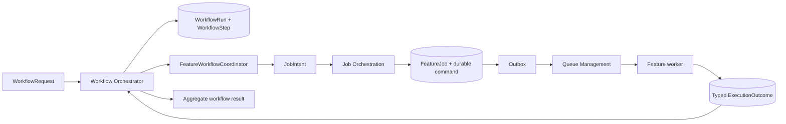
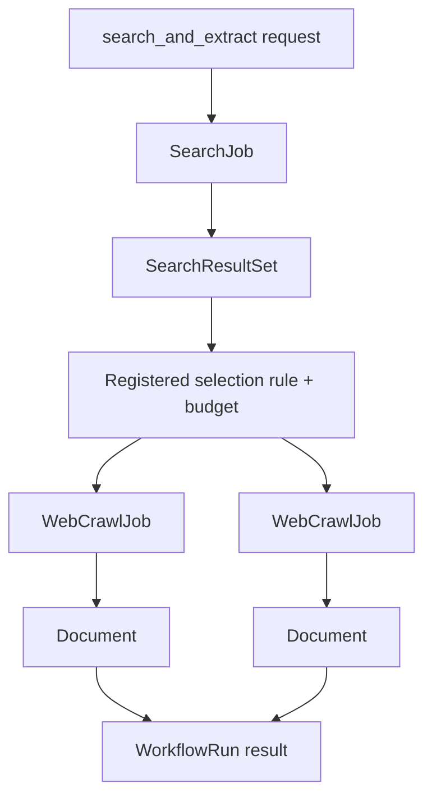

# Workflow Orchestration

## Scope

`workflow_orchestration` turns one explicit `WorkflowRequest` into a bounded graph of feature jobs. It is the only component allowed to fan out or join jobs across features, but it does so by creating `JobIntent` for Job Orchestration—not by calling another feature service or queue directly.

MVP runs no background workflow. A scheduled recrawl is a later, registered workflow type with its own quota, retention and audit policy.

## Core objects

| Object | Purpose | Key contents |
|---|---|---|
| `WorkflowRequest` | Caller intent | workflow type, URL or query, output goal, requested depth, child-job/item budget, browser permission, caller/policy context, idempotency key |
| `WorkflowDefinition` | Reviewed, versioned allowed path | step graph, feature coordinators, selection rules, terminal outcomes, limits and required approvals |
| `WorkflowRun` | Durable parent record | definition version, state, budget use, child job references, aggregate result and audit/correlation data |
| `WorkflowStep` | One resolved dependency | input reference, coordinator, state, child `FeatureJob`, typed output/error reference |
| `FeatureWorkflowCoordinator` | Feature-owned mapping | converts a permitted step input to `JobIntent`; maps typed feature result to permitted next-step input |

## Responsibility boundary

| Component | Owns | Does not own |
|---|---|---|
| `WorkflowOrchestrator` | `WorkflowRun`, step graph, budgets/depth, fan-out/fan-in and aggregate result | job lease, retry, DLQ or feature business execution |
| `FeatureWorkflowCoordinator` | declarative input/output mapping for its feature | job state, direct queue publish or cross-feature implementation |
| `JobOrchestrationService` | `FeatureJob`, command durability, idempotency, cancel/status and route | workflow graph or network action |
| `QueueManagementService` | outbox publish, lease, retry, DLQ and acknowledgement | workflow planning or command interpretation |
| Feature service | typed command validation, policy gate and execution outcome | creating downstream jobs |

## Action and data flow

## MVP workflow definitions

| Request type | Steps | Output | Boundary |
|---|---|---|---|
| `search` | `SearchJob` → normalize/deduplicate | `SearchResultSet` | Search result never becomes crawl work automatically. |
| `crawl_url` | `WebCrawlJob` → static fetch → normalize/classify | `Document` | No browser recipe, media child job or child-link follow. |
| `search_and_extract` | `SearchJob` → registered selection rule → bounded `WebCrawlJob[]` → join | `SearchResultSet` + `Document[]` references | Fan-out occurs only because the caller explicitly requested this workflow; Search worker itself never creates crawl jobs. |

The selection rule is versioned within `WorkflowDefinition`; it must respect caller/policy context and workflow budget. Every selected URL passes Network Policy again in Web Crawl before a network call.

## Media workflow definitions

| Request type | Steps | Output | Boundary |
|---|---|---|---|
| `download_image` | `ImageDownloadJob` → policy per item → stream/validate → persist | `ImageManifest` | Direct URL workflow only. |
| `extract_images` | `WebCrawlJob` → `Document` + `ImageCandidateManifest` → registered selection → `ImageDownloadJob` | `Document` + `ImageManifest` references | Page workflow; Crawl Data owns candidates. |
| `download_video` | `VideoDownloadJob` → approved-source/DRM gate → bounded download | `VideoAsset` | Direct approved-source workflow only. |
| `extract_video` | approved recipe → `Document` reference + `VideoCandidateManifest` → selection → `VideoDownloadJob` | `Document` + `VideoAsset`/manifest references | Page workflow; Video Download owns candidates. |
| `torrent_download` | Deferred; separate product/legal decision | — | Never part of Video Download. |

Media page workflows are **two-stage**: Crawl Data persists `Document` first, then Crawl Data persists `ImageCandidateManifest` for `extract_images` or Video Download persists `VideoCandidateManifest` after its approved recipe. The aggregate result carries **`document_reference`** plus the media-manifest reference. Only Workflow Orchestration may fan out from a durable candidate manifest; Crawl Data, Image Download and Video Download never call one another.

See [media candidate workflows](media-candidate-workflows.md) for manifest rules, budgets, `.mp4`/`.m3u8` handling and terminal outcomes.

## State and controls

`WorkflowRun` transitions from `pending` → `running` → (`completed` | `completed_partial` | `failed` | `blocked` | `cancelled`). A terminal child job updates its step; it is not retried by Workflow Orchestration. Queue Management remains the sole retry scheduler for typed transient job failures.

- Duplicate request in the same idempotency scope returns the existing `WorkflowRun` and its child jobs.
- Cancellation stops undispatched steps, requests cancellation for active child jobs and preserves completed outputs/audit.
- A run cannot exceed the registered count, byte, time, depth or approved-source budget.
- Workflow definitions are registered server-side; web content, search results, callers and LLMs cannot supply arbitrary steps, selectors or JavaScript.

## Version roadmap

| Version | Allowed workflow | Explicit exclusions |
|---|---|---|
| MVP v1 | `search`, `crawl_url`, `search_and_extract`; static classification of news, technical documentation, learning material and generic pages. | Browser action, media download, recursive links and schedule. |
| v1.1 | `download_image`, `extract_images`: Crawl Data persists `Document` and `ImageCandidateManifest`; workflow selects within budget and creates bounded Image Download child jobs; return partial `ImageManifest`. | Browser lazy-load and automatic page expansion. |
| v1.2 | `download_video`, `extract_video`: Video Download approved-source recipe produces `VideoCandidateManifest`; workflow selects within budget and creates bounded Video Download jobs. | Request-provided selector/JS/cookie/credential, DRM or access-control bypass. |
| v2 | `crawl_collection`: explicit depth 2–3 crawl with domain allowlist, canonical/dedupe, page/byte/time budgets and loop prevention. | Unbounded/deep domain crawl. |
| v2.1+ | Scheduled recrawl/freshness workflows registered server-side with quota, retention and audit. | Generic cron for arbitrary URL/workflow execution. |
| Later | `torrent_download` only after a separate product/legal decision and its own quota/audit design. | Treating magnet/`.torrent` as ordinary video URLs. |

## Required reviews

- New workflow definitions, selection rules, browser recipes and source registrations require policy/security review.
- A workflow result contains safe references and reason codes, never raw cookies, tokens, signed URLs, browser capture or queue payloads.
- A workflow does not grant more permission than its requesting caller or registered source policy.
