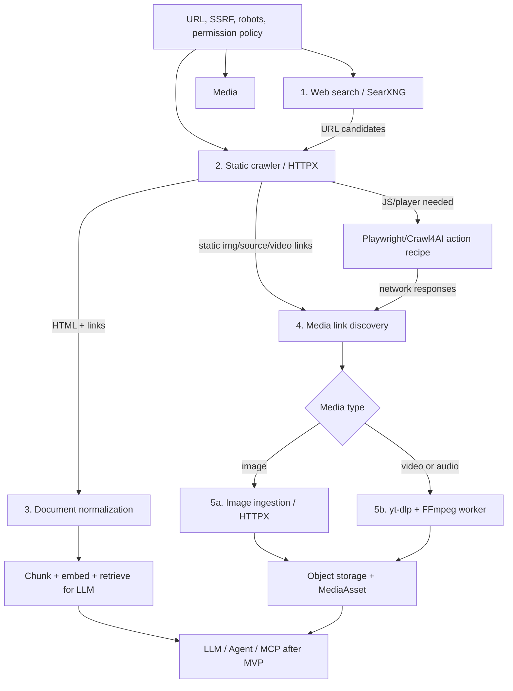
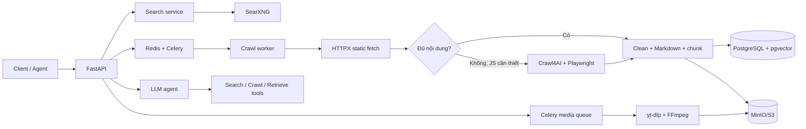

# Mini Crawler Python: lựa chọn kỹ thuật và kế hoạch triển khai

> Cập nhật: 07/11/2026  
> Trạng thái: đề xuất để triển khai MVP  
> Phạm vi: web search, crawl nội dung phục vụ LLM/agent, discovery link media và tải video/audio/ảnh từ nguồn được phép.

## 1. Mục tiêu và ranh giới

MVP là một API Python có thể:

1. tìm URL trên Internet;
2. crawl URL thành nội dung Markdown/metadata để dùng trong LLM/RAG;
3. để agent gọi các tool tìm kiếm, crawl và trả lời có dẫn nguồn;
4. phát hiện link video/audio/ảnh trong trang hoặc sau action player;
5. tạo job tải video/audio/ảnh từ URL mà người dùng có quyền tải;
6. theo dõi trạng thái, retry có kiểm soát và lưu kết quả.

MVP **không** là công cụ archive toàn bộ Internet, không tự vượt CAPTCHA/rate-limit/paywall/DRM, và không crawl hay tải nội dung trái với điều khoản sử dụng, `robots.txt` hoặc quyền sở hữu nội dung.

## 2. Kết quả đối chiếu repository tham khảo

| Repository tham khảo | Xác nhận từ repo | Quyết định áp dụng |
|---|---|---|
| `/Users/tanle/Documents/learning/searxng` | Có HTTP API `GET/POST /search`; `format=json` phải được bật trong `settings.yml`; limiter cần Valkey/Redis; license AGPL-3.0 | Self-host SearXNG bằng Docker làm metasearch; gọi bằng HTTPX, chỉ nhận JSON đã bật trong cấu hình. Không fork/nhúng source SearXNG vào ứng dụng. |
| `/Users/tanle/Documents/learning/crawl4ai` | Python `>=3.10`; `AsyncWebCrawler`; `CrawlerRunConfig`; output có Markdown, HTML sạch, links/media; `arun_many()` có dispatcher, rate limit và backoff | Dùng Crawl4AI làm browser/JS fallback và chuẩn hóa Markdown. Bật `check_robots_txt=True`; giới hạn concurrency theo domain. |
| `/Users/tanle/Documents/learning/yt-dlp` | Python `>=3.11`; nhúng được qua `YoutubeDL`; `sanitize_info` tạo metadata JSON-safe; `progress_hooks` theo dõi download; FFmpeg dùng cho hậu xử lý | Dùng thư viện `yt-dlp`, chạy trong worker riêng, lưu tiến độ job bằng progress hook. Không parse stdout để lấy trạng thái. |

Các đường dẫn trên chỉ là nguồn học tập cục bộ, không phải dependency dạng source của ứng dụng. Dependency phải được cài từ package registry và khóa phiên bản bằng `uv.lock`.

## 3. Lựa chọn stack

### 3.1 Stack bắt buộc cho MVP

| Lớp | Chọn | Lý do |
|---|---|---|
| Runtime/package | Python 3.12, `uv`, `pyproject.toml` | Thỏa điều kiện Python của Crawl4AI và yt-dlp; lock dependency tái lập được. |
| HTTP API | FastAPI, Uvicorn, Pydantic v2, `pydantic-settings` | Async API, validation rõ ràng và OpenAPI sẵn có. |
| Web search | SearXNG self-hosted, HTTPX | Tách discovery URL khỏi crawl nội dung; không phụ thuộc API search thương mại ngay từ đầu. |
| Crawl HTML tĩnh | HTTPX + `selectolax` + `markdownify` | Rẻ và nhanh hơn browser; là đường fetch mặc định. |
| Crawl JavaScript | Crawl4AI + Playwright | Chỉ gọi khi fetch tĩnh thiếu nội dung hoặc yêu cầu JS đã được xác định. |
| Video discovery động | Playwright trực tiếp, dùng Crawl4AI khi cần capture | Thực hiện action đã được phê duyệt (ví dụ: click Play), chờ player/iframe và quan sát response mạng để xác định manifest/media URL. |
| Persistence | PostgreSQL, SQLAlchemy 2, Alembic | Lưu job, metadata, audit và trạng thái idempotent. |
| Queue/cache | Redis + Celery | Tách crawl/download/embedding khỏi request HTTP; hỗ trợ retry và queue chuyên biệt. |
| Tìm kiếm local ban đầu | PostgreSQL full-text search (`tsvector`) | Giảm vận hành; đủ để kiểm tra flow ingest/retrieve trên corpus nhỏ. |
| LLM/agent | LiteLLM + PydanticAI | LiteLLM là gateway đổi model; PydanticAI định nghĩa tool input/output bằng schema. |
| Embedding | Provider qua LiteLLM; lưu vector bằng `pgvector` | Một database cho MVP; chỉ thêm index riêng sau benchmark. |
| Video/audio | `yt-dlp` Python API + FFmpeg | yt-dlp xử lý extractor/format; FFmpeg mux/convert khi được phép. |
| Image ingestion | HTTPX streaming, MIME/magic-byte validation, Pillow (optional) | Tải ảnh trực tiếp theo policy; Pillow chỉ dùng validate/đọc dimensions/tạo thumbnail, không cần yt-dlp. |
| File storage | MinIO (S3-compatible), filesystem ở local dev | Lưu raw HTML, Markdown snapshot và media tách khỏi database. |
| Quan sát | `structlog`, OpenTelemetry, Prometheus | Correlation ID, latency, lỗi upstream, queue depth và chi phí LLM. |
| Chất lượng | pytest, pytest-asyncio, respx, Ruff | Test async/upstream giả lập và kiểm tra style. |

### 3.2 Thành phần hoãn lại

| Thành phần | Chưa đưa vào MVP vì | Điều kiện thêm |
|---|---|---|
| OpenSearch | Tăng tài nguyên và vận hành so với PostgreSQL + pgvector | Corpus/độ trễ chứng minh PostgreSQL không đủ; cần BM25 + vector hybrid ở quy mô lớn. |
| Qdrant | Trùng vai trò vector store với pgvector ở giai đoạn đầu | Benchmark chứng minh lợi ích so với OpenSearch hoặc pgvector. |
| LangGraph/đa-agent | Tăng độ phức tạp điều phối và quan sát | Có workflow nhiều bước/phê duyệt mà agent đơn không đáp ứng. |
| Deep crawl/adaptive crawl | Không cần cho single-page ingestion MVP | Đã có quota theo domain, crawl scope và bộ benchmark. |
| Proxy/stealth/anti-bot | Không phải cách xử lý hợp lệ cho nội dung bị hạn chế | Không triển khai để né kiểm soát truy cập. |

## 4. Kiến trúc và luồng xử lý

### 4.0. Quan hệ feature



**Nguyên tắc quan hệ:** search chỉ tìm URL; crawler không tự động tải mọi kết quả search; document pipeline và media pipeline độc lập sau bước discovery; mọi nhánh đều phải qua cùng policy trước khi worker gọi network.



### 4.1 Search

1. `SearchService` gọi SearXNG qua `GET /search?q=...&format=json` với timeout.
2. Cấu hình SearXNG phải cho phép output JSON; nếu chưa bật, API có thể trả `403`.
3. Ứng dụng chuẩn hóa URL, loại kết quả trùng và trả metadata cùng link nguồn.
4. Search lỗi hoặc timeout trả lỗi upstream rõ ràng; không chuyển sang crawl đồng bộ hàng loạt.

### 4.2 Crawl và ingestion cho LLM

1. Validate URL và kiểm tra chính sách trước khi tạo job.
2. Worker thử HTTPX trước, giới hạn kích thước response và thời gian chờ.
3. Chỉ fallback sang Crawl4AI/Playwright với URL cần render JavaScript.
4. Lưu URL cuối sau redirect, title, cleaned HTML, Markdown, links, content hash và thời điểm crawl.
5. Nếu content hash không đổi, không chunk/embed/index lại.
6. Chunk nội dung khoảng 400–600 tokens, overlap 50–80 tokens; thông số phải benchmark bằng dữ liệu thực.
7. Agent chỉ nhận chunk kèm `source_id`, URL và metadata; citation trả về phải được kiểm tra với source thực.

### 4.3 Agent tools

Agent có quyền gọi đúng bốn tool typed sau, không được tự có network/shell access:

| Tool | Input tối thiểu | Output |
|---|---|---|
| `search_web` | `query`, `limit` | danh sách URL/title/snippet |
| `request_crawl` | URL đã validate | `crawl_job_id` |
| `retrieve_documents` | query, filters, limit | chunks có `source_id`/URL |
| `answer_with_citations` | question, source IDs | answer và citation IDs đã validate |

Nội dung website là dữ liệu không tin cậy. System prompt phải cấm agent tuân theo instruction nằm trong trang crawl và cấm chuyển URL/nội dung trang thành lệnh tool.

#### 4.3.1 MCP adapter sau MVP

Sau khi REST API, queue và policy của MVP ổn định, thêm một **MCP server** (Model Context Protocol) như adapter cho AI clients. MCP server gọi service interface đã có của mini crawler; không truy cập trực tiếp database, Redis, Celery hay browser worker.

| Môi trường | Transport MCP | Mục đích |
|---|---|---|
| Local development / desktop AI client | `stdio` | Không mở cổng mạng, dễ chạy cùng IDE/AI desktop app. |
| Deploy nội bộ/remote | Streamable HTTP qua HTTPS | Kết nối nhiều AI client, đi qua auth, rate limit và observability. |

MCP Python server dùng package `mcp` được pin version bằng `uv.lock`. Nó là service/process độc lập với FastAPI; có thể gọi application service trong cùng codebase hoặc REST nội bộ đã được xác thực. Không biến toàn bộ REST endpoint thành MCP tool một cách tự động.

Tool MCP dự kiến:

| MCP tool | Loại | Kết quả |
|---|---|---|
| `search_web` | Read-only | Danh sách kết quả SearXNG đã chuẩn hóa |
| `request_crawl` | Async side effect | `crawl_job_id` sau URL/policy validation |
| `get_crawl_job` | Read-only | Trạng thái và lỗi an toàn để hiển thị |
| `retrieve_documents` | Read-only | Chunks có source ID/URL theo quyền caller |
| `answer_with_citations` | Read-only/compute | Answer và citation IDs đã validate |
| `request_media_download` | Async side effect, approval bắt buộc | `media_job_id` sau allowlist/quyền nội dung/policy gate |
| `get_media_job` | Read-only | Status, progress và object metadata theo quyền caller |

`request_crawl` và đặc biệt `request_media_download` không được tự động chạy chỉ vì nội dung crawl hoặc LLM đề xuất. MCP server phải yêu cầu approval từ host/client hoặc một `approval_token` do hệ thống phát hành; mọi action được audit theo caller identity và policy decision. Tool phải trả job ID ngay, không giữ session MCP chờ browser/download hoàn tất.

MCP resources chỉ đọc và luôn authorization-aware, ví dụ `mini-crawler://documents/{document_id}` hoặc `mini-crawler://jobs/{job_id}`. Không expose raw HTML, network capture, cookie, token hoặc object-storage URL ký dài hạn qua resource/tool response.

### 4.4 Download media

Một video player hiện đại có thể không lộ URL media trong HTML ban đầu. URL `.m3u8`, `.mpd`, hoặc `mp4` chỉ xuất hiện sau khi JavaScript khởi tạo player, người dùng click Play, hoặc iframe tải xong. Vì vậy `yt-dlp` là downloader, không phải tầng duy nhất để discovery.

#### 4.4.1 Video discovery worker

`VideoDiscoveryWorker` chạy Playwright trực tiếp. Dùng API Playwright trực tiếp cho luồng click/wait/frame cụ thể; dùng Crawl4AI cho crawl/capture tích hợp khi phù hợp. Worker giữ browser context riêng cho từng job và không dùng context đã xác thực của người khác.

1. API nhận URL, format mong muốn và xác nhận người dùng có quyền tải.
2. Validate URL, kiểm tra allowlist domain và policy trước khi mở browser.
3. Mở URL bằng browser context sandboxed; theo dõi request/response trước khi action. Với Crawl4AI, bật `capture_network_requests=True`.
4. Chạy một **action recipe** đã đăng ký cho domain, chẳng hạn `wait_for(player) → click(play_button) → wait_for(player_state/network_event)`. Không nhận JavaScript/selector tùy ý từ API hay LLM.
5. Kiểm tra frame/iframe được cho phép; chờ player bắt đầu tải; thu thập response có content type hoặc URL chỉ ra `application/vnd.apple.mpegurl`, HLS (`.m3u8`), DASH (`.mpd`) hoặc file media trực tiếp.
6. Lưu ứng viên stream dưới dạng metadata tạm thời, redacted headers và bằng chứng discovery; không log cookie/token/query secrets.
7. Kiểm tra entitlement và DRM trước download. Dấu hiệu DRM, ví dụ encrypted-media/EME hoặc DASH `ContentProtection`, tạo trạng thái `blocked_drm`; không thử bypass.
8. Nếu policy cho phép, tạo `MediaDownloadJob` trong queue `media`; không download trong process FastAPI.
9. Worker gọi `YoutubeDL.extract_info(url, download=False)` để kiểm tra metadata; dùng `sanitize_info` trước khi lưu JSON.
10. Worker thực hiện download bằng `YoutubeDL`; `progress_hooks` cập nhật tiến độ/status cho job. Cấu hình HLS/DASH do yt-dlp/FFmpeg xử lý khi nguồn cho phép.
11. FFmpeg chỉ dùng để ghép/chuyển đổi format được yêu cầu và hợp lệ; file output đưa vào object storage.

#### 4.4.2 Action recipe an toàn

Mỗi domain được hỗ trợ có một recipe versioned trong server-side configuration:

| Trường | Ý nghĩa |
|---|---|
| `allowed_domains` | Domain trang player, iframe và CDN được phép quan sát/tải |
| `steps` | Chuỗi hữu hạn: `wait`, `click`, `scroll`, `select_frame` |
| `selector` | Selector đã review trong source control, không do người dùng/LLM cung cấp |
| `expected_state` | Element/state/network event chứng minh action thành công |
| `timeout_ms` | Giới hạn từng bước và toàn bộ recipe |
| `max_actions` | Chặn vòng lặp/action không giới hạn |

Browser không được tự login, điền biểu mẫu thanh toán, giải CAPTCHA, bấm consent bất thường, hoặc chạy JavaScript tự do từ URL/LLM. Session có thể dùng credential service account chỉ cho domain do tổ chức sở hữu hoặc đã có ủy quyền rõ ràng.

Không hỗ trợ DRM hoặc cơ chế vượt kiểm soát truy cập. Khi URL không được phép, job bị từ chối với lý do rõ ràng.

#### 4.4.3 Image ingestion

Ảnh là nhánh media riêng, không cần browser action nếu URL nằm trong HTML/CSS/source set. Static crawler thu thập URL từ `img`, `picture/source`, Open Graph/Twitter image metadata và link ảnh đã chuẩn hóa; browser discovery chỉ dùng khi ảnh được lazy-load bằng JavaScript trên domain được phép.

1. `MediaLinkDiscoveryService` chuẩn hóa, loại trùng và gắn loại dự đoán `image` cho candidate URL.
2. `ImageIngestionWorker` kiểm tra policy/allowlist, fetch bằng HTTPX streaming, giới hạn redirect và kích thước file.
3. Xác minh `Content-Type` và magic bytes trước persist; từ chối SVG/script payload hoặc loại không cho phép theo policy.
4. Tùy chọn dùng Pillow để đọc dimensions, phát hiện ảnh lỗi và tạo thumbnail; không chạy biến đổi nặng trong API process.
5. Lưu object vào MinIO/S3 và `MediaAsset` gồm canonical URL, MIME type, byte size, dimensions, content hash và object key.

Image ingestion không tải toàn bộ ảnh trang theo mặc định. API/job phải nêu rõ mode, ví dụ `featured_only`, `discovered_links` hoặc một danh sách URL đã được policy cho phép.

## 5. Bảo mật, tuân thủ và giới hạn tài nguyên

- Chỉ cho phép `http`/`https`; từ chối `file:`, `data:`, `javascript:` và URL có user-info.
- Chống SSRF: resolve DNS trước và sau redirect, chặn localhost, loopback, private/link-local/multicast ranges và metadata endpoints; triển khai worker trong network egress hạn chế.
- Bật và tôn trọng `check_robots_txt=True`; lưu user-agent minh bạch; áp dụng allowlist/denylist domain khi cần.
- Rate limit theo domain, bounded concurrency, exponential backoff cho `429`/`503`, giới hạn retry và có dead-letter queue.
- Không lưu cookie hay credential do người dùng gửi để crawl/download URL tùy ý. Secret model/provider đặt trong server-side configuration.
- Video discovery chỉ được thực hiện trên player/iframe/CDN trong allowlist của recipe; network capture phải redaction `Cookie`, `Authorization`, signed query token và request body trước khi persist/log.
- Giới hạn response bytes, số redirect, số trang/job, token context, kích thước file và thời gian xử lý FFmpeg.
- SearXNG chỉ bind private network; secret key là biến môi trường; bật limiter khi expose service và dùng Redis/Valkey theo yêu cầu của SearXNG.
- Ghi audit log cho URL, requester, policy decision, job status và file/object key; tránh log token, cookie và nội dung nhạy cảm.

## 6. Mô hình dữ liệu tối thiểu

| Entity | Trường cốt lõi |
|---|---|
| `CrawlJob` | `id`, `url`, `status`, `attempts`, `requested_by`, `policy_decision`, timestamps |
| `Document` | `id`, `canonical_url`, `title`, `content_hash`, `language`, `storage_key`, crawl timestamps |
| `DocumentChunk` | `id`, `document_id`, `chunk_index`, `content`, `token_count`, `embedding` |
| `MediaLink` | `id`, `document_id`, `url`, `media_type`, `discovery_method`, `policy_status` |
| `MediaDownloadJob` | `id`, `media_link_id`, `media_type`, `status`, `format_policy`, `progress`, `error_code`, timestamps |
| `MediaAsset` | `id`, `job_id`, `title`, `duration`, `mime_type`, `byte_size`, `dimensions`, `content_hash`, `storage_key`, `source_metadata` |

Ràng buộc quan trọng: `canonical_url` và `content_hash` phải có index; tạo idempotency key cho mọi job để tránh tải/crawl trùng khi retry.

## 7. Cấu trúc project đề xuất

```text
mini-crawler/
├── app/
│   ├── api/                 # routers: search, crawl, documents, answers, media
│   ├── core/                # settings, logging, security, errors
│   ├── schemas/             # Pydantic request/response models
│   ├── services/            # orchestration và business rules
│   ├── providers/           # searxng, static fetch, crawl4ai, llm, ytdlp, storage
│   ├── video_recipes/       # action recipes đã review theo domain
│   ├── repositories/        # SQLAlchemy data access
│   ├── workers/             # Celery tasks và queue routing
│   └── main.py
├── tests/
│   ├── unit/
│   └── integration/
├── infra/
│   └── searxng/settings.yml
├── docker-compose.yml
├── pyproject.toml
└── uv.lock
```

Provider interface tách riêng để app không phụ thuộc trực tiếp vào SearXNG, Crawl4AI, LiteLLM hay yt-dlp. Việc thay provider không được làm thay đổi contract API.

## 8. Kế hoạch triển khai theo phase

### Phase 0 — Bootstrap và guardrails

- Khởi tạo Python 3.12, `uv`, FastAPI, Docker Compose, Ruff và pytest.
- Tạo config typed, structured logging, correlation ID và health endpoints.
- Khởi động SearXNG local; bật `json` format, bind private network, không hard-code secret.
- Viết test cho config, URL validation và SSRF policy trước khi viết implementation.

**Hoàn thành khi:** container chạy được; `/health/live` trả OK; URL private/local bị từ chối bởi test.

### Phase 1 — Live web search

- Cài `SearxngSearchProvider` qua HTTPX, timeout và error mapping.
- Tạo `GET /api/v1/search?q=&limit=`.
- Dùng fixture/mocked SearXNG trong unit test; integration test chỉ chạy với local SearXNG.

**Hoàn thành khi:** API trả title/URL/snippet đã validate, JSON format không bị 403, và lỗi timeout không làm ứng dụng dừng.

### Phase 2 — Crawl một trang thành tài liệu LLM-ready

- Tạo `CrawlPolicyService`, static fetcher và Markdown normalizer.
- Tạo adapter Crawl4AI cho JS fallback; tái sử dụng browser, không tạo browser context không giới hạn.
- Lưu `CrawlJob`/`Document`; canonicalize URL và deduplicate bằng hash.
- Expose `POST /api/v1/crawl/jobs` và `GET /api/v1/crawl/jobs/{id}`.

**Hoàn thành khi:** URL hợp lệ tạo job async, trang HTML/JS phù hợp tạo Markdown và redirect/duplicate được xử lý đúng.

### Phase 3 — Retrieval và AI answer có citation

- Chunk, embedding và lưu `pgvector` sau khi crawl thành công.
- Thêm full-text retrieval PostgreSQL; hợp nhất lexical/vector bằng RRF khi có cả hai kết quả.
- Cài LiteLLM gateway và PydanticAI tools với quyền tối thiểu.
- Tạo `POST /api/v1/answers`; validate mọi citation ID trước response.

**Hoàn thành khi:** answer chỉ trích dẫn document/chunk đã retrieve; nguồn thiếu thì trả trạng thái không đủ bằng chứng thay vì bịa citation.

### Phase 4 — Media download có kiểm soát

- Tạo `POST /api/v1/media/jobs` và `GET /api/v1/media/jobs/{id}`; request chỉ rõ loại `image`, `audio` hoặc `video` và mode ingest.
- Tạo `MediaLinkDiscoveryService` cho static HTML/metadata; chỉ khởi động `VideoDiscoveryWorker` Playwright nếu player cần action hoặc JS để lộ media link.
- Tạo `ImageIngestionWorker` dùng HTTPX streaming, MIME/magic-byte/size validation và Pillow optional cho image metadata/thumbnail.
- Tách queue `media` với concurrency thấp; discovery browser và download yt-dlp dùng queue/worker pool riêng để browser không làm nghẽn download.
- Tích hợp yt-dlp Python API, FFmpeg và object storage; lưu metadata JSON-safe và tiến độ từ `progress_hooks`.
- Ghi trạng thái phân biệt `stream_not_found`, `blocked_policy`, `blocked_drm`, `failed` và `completed`.

**Hoàn thành khi:** một player do nhóm sở hữu/được ủy quyền có thể click Play bằng recipe, nhận diện stream response hợp lệ và tải thành công; một ảnh được phép tải qua `ImageIngestionWorker` với MIME/size validation; URL/domain/DRM/loại file không hợp lệ bị chặn trước download.

### Phase 5 — Hardening và quyết định mở rộng index

- Thêm metrics: search/crawl/download latency, 429 ratio, browser memory, queue depth, crawl success, document freshness và LLM token cost.
- Chạy benchmark câu hỏi đại diện, crawling load và failure scenarios.
- Đánh giá PostgreSQL full-text + pgvector so với OpenSearch bằng P95 latency, Recall@k, chi phí vận hành và dung lượng.

**Hoàn thành khi:** có số liệu để quyết định giữ PostgreSQL hoặc thêm OpenSearch, không dựa vào giả định.

### Phase 6 — MCP server cho AI clients (sau MVP)

- Tạo MCP server Python độc lập, pin package `mcp`, dùng `stdio` ở local và Streamable HTTP/HTTPS khi deploy nội bộ.
- Ánh xạ các application service đã ổn định sang tool schemas typed; duy trì REST API là public/internal API độc lập.
- Áp dụng authentication theo caller identity, authorization theo document/job ownership, rate limit và correlation ID xuyên qua MCP → service → worker.
- Bắt approval cho crawl/media side effect; tool trả job ID và status được đọc qua tool riêng.
- Thêm resource read-only có access check; redact bí mật, content không được phép và metadata network nhạy cảm.
- Test MCP protocol/contract với client fixture; kiểm tra schema, quyền truy cập, approval denial, timeout và prompt-injection content.

**Hoàn thành khi:** một AI client local gọi được tool qua `stdio`; một client nội bộ đã xác thực gọi được qua Streamable HTTP; caller không có quyền không đọc được document/job và không khởi tạo crawl/download không có approval.

## 9. Chiến lược kiểm thử

- **Unit:** URL/SSRF policy, canonicalization, content hash, chunking, RRF, citation validation, yt-dlp option builder.
- **Provider contract:** mock HTTPX/SearXNG; fake Crawl4AI/yt-dlp/LLM để test lỗi timeout, 403/429, malformed result và retry.
- **Integration:** SearXNG + PostgreSQL + Redis qua Docker Compose; một target test do nhóm sở hữu.
- **E2E:** search → crawl job → retrieve → cited answer; player fixture do nhóm kiểm soát → Play action → network discovery → media job từ nguồn được quyền tải.
- **Security:** redirect về private IP, oversized response, prompt injection trong Markdown, invalid media URL, recipe vượt allowlist, redaction network capture và duplicate job.
- **MCP contract (sau MVP):** `stdio` và Streamable HTTP client fixtures; tool schema, caller authorization, approval required, async job polling và resource redaction.

Mỗi thay đổi code theo TDD: test fail (Red), implementation tối thiểu (Green), rồi refactor. Không chạy crawl/download thật trong unit test.

## 10. API MVP dự kiến

| Method | Path | Chức năng |
|---|---|---|
| `GET` | `/api/v1/search` | Search live qua SearXNG |
| `POST` | `/api/v1/crawl/jobs` | Tạo crawl job async |
| `GET` | `/api/v1/crawl/jobs/{id}` | Đọc trạng thái crawl |
| `GET` | `/api/v1/documents/{id}` | Đọc document đã chuẩn hóa |
| `POST` | `/api/v1/answers` | Retrieve + LLM answer có citation |
| `POST` | `/api/v1/media/jobs` | Tạo media download job đã qua policy |
| `GET` | `/api/v1/media/jobs/{id}` | Đọc trạng thái/tài sản media |
| `GET` | `/health/live`, `/health/ready` | Health checks |

MCP không thay thế các endpoint trên. Khi deploy remote, MCP server cung cấp transport Streamable HTTP qua một ingress/route riêng, chỉ dành cho AI clients đã xác thực.

## 11. MCP policy tối thiểu sau MVP

- MCP server không có quyền lớn hơn REST/service caller; mọi request mang caller identity và tenant/scope nếu hệ thống có multi-tenant.
- Schema tool là contract có version; thêm field theo hướng backward-compatible và deprecate trước khi xóa.
- Nội dung website trong tool/resource response vẫn là untrusted data, không thể nâng quyền hay tạo tool instruction.
- Chỉ các tool read-only được default-enable. Crawl/download phải explicit-enable theo AI client, domain policy và approval flow.
- Log audit gồm MCP client, tool name, request ID, policy result, job ID và latency; không log secret hoặc raw captured network data.

## 12. Tiêu chí để bắt đầu code

Trước Phase 0, cần chốt với người sở hữu sản phẩm:

1. Danh sách domain được crawl/download và chính sách quyền nội dung.
2. Provider/model LLM, ngân sách token và quy tắc retention dữ liệu.
3. Nơi triển khai (local/VPS/cloud), object storage và yêu cầu xác thực người dùng.
4. Bộ câu hỏi/URL benchmark đại diện để đo chất lượng retrieval và hiệu năng.

Sau khi các quyết định này được phê duyệt, triển khai lần lượt từ Phase 0; không triển khai toàn bộ stack cùng lúc.
