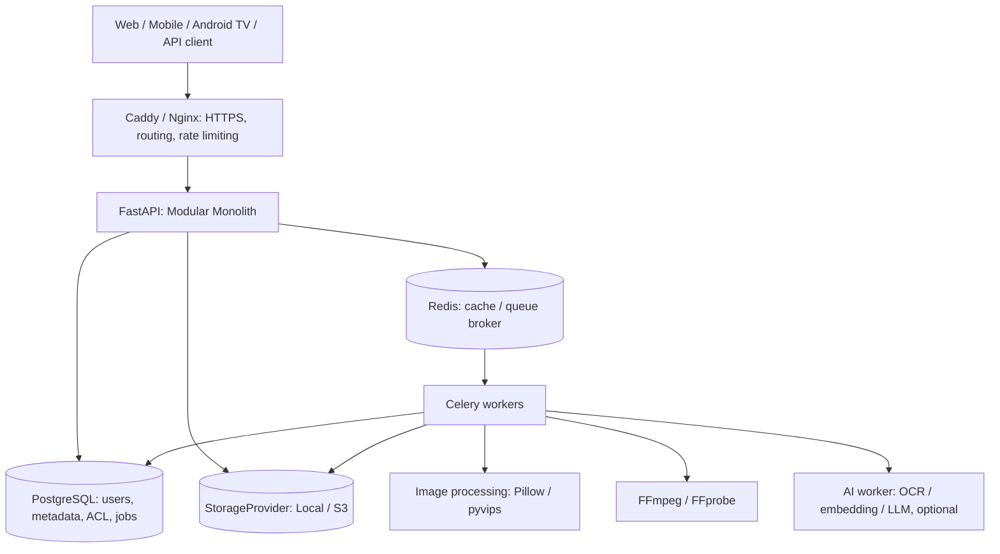
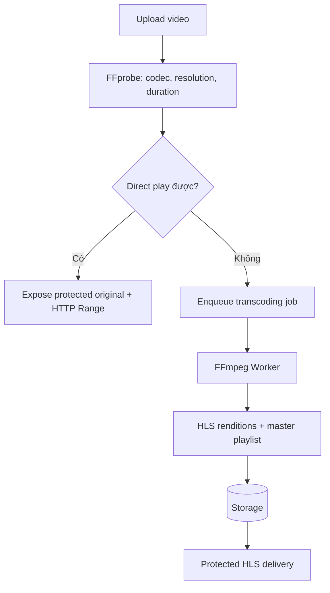
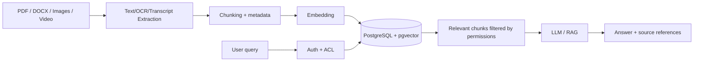

# Mini Nextcloud Server — Thiết kế kiến trúc với FastAPI

> **Mục tiêu:** Xây dựng cloud storage & media server self-hosted nhỏ gọn, hỗ trợ lưu trữ file, resize ảnh, chuyển video sang HLS, auth/phân quyền và mở rộng AI/LLM về sau.
>
> **Định hướng:** Modular Monolith + Background Workers; local-first, hỗ trợ S3-compatible storage khi mở rộng.

## Trạng thái trong Mini Crawler

Mini Crawler hiện lưu document/asset qua `StorageAdapter` vào **MinIO/S3-compatible**
storage. Tài liệu này mô tả **Mini Nextcloud là một learning/product path độc lập**,
không phải service hay module đang chạy trong crawler.

| Giai đoạn của Mini Nextcloud | Storage/service dùng | Ranh giới an toàn |
|---|---|---|
| Trước khi xây Mini Nextcloud | Self-hosted Nextcloud qua reviewed WebDAV/API | Chỉ dùng cho standalone project; kiểm tra ACL, credential và upload boundary của chính project đó. |
| Khi Mini Nextcloud sẵn sàng | Mini Nextcloud thay Nextcloud tại integration point của standalone project | Giữ metadata tách binary, server-generated object key và result reference; không chuyển file production tự động. |

Đây **không phải current crawler-storage migration**: crawler vẫn dùng MinIO/S3-compatible
storage theo runtime hiện tại. Không tạo `app/features/nextcloud/`, provider interface
hay cờ cấu hình mới để chuẩn bị trước; chỉ tạo seam nhỏ nhất tại call site thật khi có
implementation thứ hai đã chạy và được phê duyệt.

### Điều kiện chuyển provider sau này

Chỉ chuyển controlled traffic trong standalone Mini Nextcloud project khi:

1. integration target được kiểm soát và các file/object operation an toàn tương đương đã được test;
2. credential, signed URL và provider-specific payload được redaction, không đi vào result/job data;
3. có rollback về Nextcloud; và
4. mọi binary-object move có data migration được phê duyệt riêng, có backup/restore và rollback.

Không dual-write hoặc tự di chuyển dữ liệu trong giai đoạn tài liệu này. Các quy tắc
auth/ACL, upload validation, quota và media safety bên dưới vẫn áp dụng đầy đủ.

## 1. Lựa chọn ngôn ngữ và stack

| Tiêu chí | Python + FastAPI | Node.js + NestJS | Java + Spring Boot |
|---|---|---|---|
| Upload/download | Tốt | Rất tốt | Rất tốt |
| Xử lý ảnh | Rất tốt (Pillow, pyvips) | Tốt (sharp) | Tốt |
| FFmpeg/HLS | Rất tốt | Tốt | Rất tốt |
| AI/LLM/RAG | Hệ sinh thái mạnh | Tốt | Tốt |
| Auth/RBAC | Tốt, cần lựa chọn thư viện | Rất tốt | Rất tốt |
| Xây MVP | Nhanh | Nhanh | Trung bình |
| CPU-bound | Chuyển sang worker/process | Chuyển sang worker/process | Có ưu thế đa luồng |

**Khuyến nghị: Python + FastAPI.** Lý do: phù hợp với định hướng FastAPI hiện tại, dễ tích hợp xử lý media, AI/LLM và xây API async. Không chạy FFmpeg/transcoding hoặc inference nặng trực tiếp trong request handler.

### Stack đề xuất

| Tầng | Công nghệ |
|---|---|
| Backend | Python, FastAPI, Pydantic v2 |
| ORM/migration | SQLAlchemy 2.x, Alembic |
| Database | PostgreSQL |
| Cache/message broker | Redis |
| Background jobs | Celery |
| Object storage | Local filesystem, sau đó adapter S3-compatible |
| Image | Pillow (MVP), pyvips (khi tải lớn) |
| Video | FFprobe, FFmpeg (H.264/AAC, HLS) |
| Auth | JWT/OIDC, Argon2id; có thể tích hợp Keycloak |
| Proxy/TLS | Caddy hoặc Nginx |
| Client | Vue 3/React; Android/Android TV về sau |
| AI | Ollama, embeddings, pgvector (giai đoạn sau) |
| Deployment | Docker Compose |

## 2. Phạm vi sản phẩm và tính năng

### Phase 1 — Cloud Storage Core

- Đăng ký/đăng nhập (hoặc tài khoản tạo bởi admin), logout, refresh session.
- Upload/download, danh sách file, tạo folder, rename/move/delete.
- Trash và retention; quota dung lượng theo user.
- Metadata: owner, tên gốc, MIME, size, checksum, ngày tạo/cập nhật.
- Quyền đọc/ghi/chia sẻ theo resource; phân trang, lọc/tìm kiếm metadata.

### Phase 2 — Media Server

- Thumbnail và preview ảnh nhiều kích thước; WebP/AVIF khi môi trường hỗ trợ.
- EXIF orientation và quy tắc loại bỏ metadata nhạy cảm trong preview.
- FFprobe trích xuất codec, độ phân giải, duration, FPS.
- Phát trực tiếp file gốc (HTTP Range) khi client hỗ trợ.
- Transcode video thành HLS async, theo dõi trạng thái và tiến độ job.
- Các rendition 480p/720p/1080p tùy nguồn, CPU/GPU và nhu cầu.

### Phase 3 — Cloud nâng cao

- Resumable upload theo giao thức tus hoặc giao thức chunk có kiểm soát.
- Link chia sẻ có hạn dùng/mật khẩu/số lượt tải.
- Versioning, deduplication (tùy nhu cầu), đồng bộ desktop/mobile.
- WebDAV (nếu cần tích hợp file manager bên ngoài).
- Dashboard trạng thái job và storage usage.

### Phase 4 — AI Cloud

- OCR và extraction PDF/DOCX, index tài liệu.
- Embeddings + semantic search bằng pgvector.
- RAG/chat với tập tài liệu được cấp quyền.
- Speech-to-text, phụ đề, tìm video bằng transcript.
- Gắn tag ảnh/video và tìm kiếm ngôn ngữ tự nhiên.

## 3. Kiến trúc tổng quan



Các module nghiệp vụ nằm trong backend chung: `auth`, `users`, `folders`, `files`, `sharing`, `images`, `videos`, `jobs`, `search` và (sau này) `ai`. Worker có thể triển khai bằng container riêng để giới hạn CPU/RAM và concurrency.

**Nguyên tắc:** API nhận request, xác thực/phân quyền, cập nhật metadata, enqueue công việc; worker xử lý tác vụ nặng, lưu kết quả vào storage, cập nhật trạng thái job trong PostgreSQL. Redis không thay thế nguồn dữ liệu trạng thái bền vững.

## 4. Thiết kế Storage

Tách **metadata trong PostgreSQL** khỏi **binary trên disk/S3**. Không lưu toàn bộ file vào DB. Server sinh `storage_key`, không dùng đường dẫn do client gửi lên để ghi file vật lý.

### Storage abstraction

```python
from typing import Protocol, BinaryIO

class StorageProvider(Protocol):
    async def save(self, key: str, stream: BinaryIO) -> None: ...
    async def open(self, key: str) -> BinaryIO: ...
    async def delete(self, key: str) -> None: ...
    async def exists(self, key: str) -> bool: ...
```

Đây là **interface minh họa**, chưa phải implementation streaming hoàn chỉnh. Trong production nên dùng API theo chunk hoặc async iterator, đóng stream chính xác, giới hạn số lượng request đồng thời và đảm bảo upload atomic.

```text
StorageProvider
├── LocalStorageProvider   -> /data/storage/
└── S3StorageProvider      -> S3-compatible object storage
```

### Bố cục dữ liệu đề xuất

```text
/data/
├── originals/
│   └── ab/cd/<storage-id>
├── derived/
│   ├── images/<file-id>/thumb_200.webp
│   ├── images/<file-id>/preview_800.webp
│   └── videos/<file-id>/<version>/
│       ├── master.m3u8
│       ├── 720p/
│       └── 480p/
├── temporary/uploads/
└── quarantine/
```

Giữ original bất biến khi có thể; derived media là dữ liệu có thể tái tạo. Dùng version/content hash trong đường dẫn cache để tránh trả bản preview/HLS cũ sau khi file đổi.

### Upload lớn / resumable

1. **Initialize:** auth, quota, tạo upload session, TTL và kích thước dự kiến.
2. **Upload chunks:** nhận các phần, giới hạn size/concurrency.
3. **Resume:** dựa trên offset được xác nhận bởi server.
4. **Finalize:** kiểm tra size, checksum, loại file thực tế, chính sách bảo mật.
5. **Commit:** lưu file an toàn và metadata; xử lý rollback/orphan cleanup.
6. **Process:** enqueue thumbnail/transcoding khi cần.

Ưu tiên **tus/tusd** cho resumable upload thay vì tự phát minh giao thức mới; MVP có thể bắt đầu bằng `UploadFile` cho file nhỏ. Không nạp cả file lớn vào RAM.

## 5. Image Processing

Mục tiêu: preview nhanh, thumbnail thống nhất, cache tốt, không làm nghẽn API.

```text
Original image
├── 200x200 thumbnail WebP
├── 400x400 thumbnail WebP
├── 800px preview WebP
└── 1600px preview WebP
```

API ví dụ:

```http
GET /api/v1/files/{id}/preview?w=400&h=400&fit=cover
```

Luồng xử lý:

1. Kiểm tra ACL.
2. Validate kích thước, format, `fit` theo allowlist.
3. Sinh cache key từ `file_version + width + height + fit + format`.
4. Trả cache nếu có; nếu chưa có thì xử lý hoặc tạo job.
5. Lưu kết quả vào `media_variants` và storage.

Ví dụ với Pillow:

```python
from io import BytesIO
from PIL import Image, ImageOps

def create_thumbnail(source: str, width: int = 400, height: int = 400) -> bytes:
    with Image.open(source) as image:
        image = ImageOps.exif_transpose(image)
        image = image.convert("RGB")
        image = ImageOps.fit(
            image, (width, height), method=Image.Resampling.LANCZOS
        )
        output = BytesIO()
        image.save(output, format="WEBP", quality=82)
        return output.getvalue()
```

**Chú ý production:** giới hạn pixel giải mã, kích thước output, loại file, timeout, memory; chống decompression bomb; không cho phép resize vô hạn theo query; cân nhắc loại bỏ EXIF khỏi derived image. `pyvips` hữu ích khi cần xử lý ảnh lớn/throughput cao.

## 6. Video: Direct Play, Remux và HLS

Ưu tiên theo thứ tự chi phí:

| Mode | Ý nghĩa | Khi dùng |
|---|---|---|
| Direct Play | Phát original bằng byte-range | Codec/container tương thích client |
| Remux | Đổi container, không encode lại codec | Codec tương thích, container không phù hợp |
| Transcode HLS | Encode codec/độ phân giải mới | Thiết bị không hỗ trợ hoặc cần adaptive bitrate |

### Pipeline xử lý



Ví dụ chuyển **một rendition 720p** (không phải adaptive HLS hoàn chỉnh):

```bash
ffmpeg -i input.mp4 \
  -vf "scale=-2:720" \
  -c:v libx264 -preset veryfast -crf 23 \
  -c:a aac -b:a 128k \
  -hls_time 6 -hls_playlist_type vod \
  -hls_segment_filename "segment_%04d.ts" \
  output.m3u8
```

Adaptive bitrate cần nhiều rendition, keyframe alignment, playlist/master manifest và bitrate ladder phù hợp. Không upscale video kém chất lượng. Giới hạn concurrency worker; ưu tiên hardware encode (QSV/NVENC/VAAPI) khi có và đã kiểm thử.

Mỗi job gồm `id`, `type`, `file_id`, `status`, `progress`, `attempt`, `error`, `created_at`, `updated_at`. Tập trạng thái ví dụ: `PENDING`, `PROCESSING`, `COMPLETED`, `FAILED`, `CANCELLED`.

**Bảo vệ HLS:** Playlist và **mọi segment** đều phải tuân thủ quyền truy cập; dùng signed URLs ngắn hạn hoặc reverse proxy internal redirect có kiểm tra ACL. Không chỉ bảo vệ `master.m3u8`.

## 7. Authentication & Authorization

### Lựa chọn

- **MVP nhỏ:** FastAPI với password hashing Argon2id, short-lived JWT access token, refresh token rotation và revoke; lưu session và audit.
- **Nhiều ứng dụng/SSO:** OIDC provider chuyên dụng như Keycloak. Có thể tích hợp từ đầu nếu đây là nhu cầu chắc chắn.

### Mô hình quyền

- **RBAC:** `ADMIN`, `USER` (quyền cấp hệ thống).
- **Resource ACL:** `READ`, `WRITE`, `DELETE`, `SHARE`, owner; áp dụng cho file/folder và kế thừa hợp lý.
- **Public share:** token ngẫu nhiên đủ mạnh, có thời hạn, mật khẩu tùy chọn, giới hạn download.
- **Quota:** giới hạn dung lượng mỗi user; lưu ý tính quota với phiên bản file, derived media và upload tạm.

**Ràng buộc:** Kiểm tra ACL ở *mọi* endpoint metadata, download, preview, HLS, share và AI/RAG. Không tin cậy MIME, filename, extension hay storage key gửi từ client. Có rate limiting, audit logging, giới hạn upload và phương án virus scan/quarantine.

## 8. Database schema

| Table | Mô tả |
|---|---|
| `users` | Tài khoản, trạng thái, quota |
| `sessions` | Device/session và refresh token |
| `folders` | Cây thư mục, parent, owner |
| `files` | Tên logic, folder, owner, metadata |
| `file_versions` | Lịch sử version của một file |
| `storage_objects` | Provider, storage key, checksum, size |
| `file_permissions` | ACL theo file/folder và principal |
| `share_links` | Public link, token hash, expiry, giới hạn |
| `upload_sessions` | Trạng thái resumable upload, offset, TTL |
| `media_variants` | Thumbnail/preview/rendition/HLS manifest |
| `processing_jobs` | Công việc async, trạng thái, retry |
| `audit_logs` | Ai đã làm gì, thời điểm, kết quả |

Gợi ý bổ sung: unique constraint cho tên file/folder trong cùng thư mục tùy chính sách; index `(owner_id, folder_id)`, `(file_id, version)`; soft delete/trash; consistency checks cho orphan blobs; transactional outbox nếu sau này cần bảo đảm phát job sau commit metadata. Dedup cần reference counting, kiểm soát ACL và GC an toàn.

## 9. API REST đề xuất

| Method | Path | Mục đích |
|---|---|---|
| POST | `/api/v1/auth/login` | Đăng nhập |
| POST | `/api/v1/auth/refresh` | Refresh token |
| POST | `/api/v1/files` | Upload file nhỏ |
| GET | `/api/v1/files` | List/search metadata |
| GET | `/api/v1/files/{id}` | File metadata |
| GET | `/api/v1/files/{id}/download` | Download/Range |
| DELETE | `/api/v1/files/{id}` | Đưa file vào trash |
| POST | `/api/v1/folders` | Tạo folder |
| GET | `/api/v1/files/{id}/preview` | Image preview |
| POST | `/api/v1/videos/{id}/transcode` | Tạo transcoding job (202) |
| GET | `/api/v1/videos/{id}/status` | Trạng thái xử lý |
| GET | `/api/v1/videos/{id}/playback` | Playback metadata + URL được bảo vệ |
| GET | `/api/v1/jobs/{id}` | Trạng thái worker job |
| POST | `/api/v1/shares` | Tạo share link |

Ví dụ phản hồi `202 Accepted`:

```json
{
  "job_id": "job_123",
  "status": "PENDING",
  "type": "VIDEO_TRANSCODE",
  "progress": 0
}
```

Dùng polling hoặc Server-Sent Events để hiển thị progress. Download hỗ trợ `Range`, `ETag`, `Content-Disposition` và cache headers phù hợp.

## 10. Cấu trúc mã nguồn

```text
mini-cloud/
├── app/
│   ├── main.py
│   ├── core/
│   │   ├── config.py
│   │   ├── security.py
│   │   ├── database.py
│   │   └── exceptions.py
│   ├── modules/
│   │   ├── auth/
│   │   │   ├── router.py
│   │   │   ├── service.py
│   │   │   ├── repository.py
│   │   │   ├── models.py
│   │   │   └── schemas.py
│   │   ├── files/
│   │   ├── folders/
│   │   ├── images/
│   │   ├── videos/
│   │   ├── sharing/
│   │   ├── jobs/
│   │   └── ai/
│   ├── infrastructure/
│   │   ├── storage/
│   │   │   ├── base.py
│   │   │   ├── local.py
│   │   │   └── s3.py
│   │   ├── media/
│   │   │   ├── ffmpeg.py
│   │   │   └── image_processor.py
│   │   └── queue/
│   │       ├── celery_app.py
│   │       └── tasks.py
│   └── shared/
│       ├── dependencies.py
│       └── pagination.py
├── alembic/
├── tests/
├── docker/
├── docker-compose.yml
├── pyproject.toml
└── .env.example
```

Mapping từ Spring Boot: `router.py` ≈ Controller; `service.py` ≈ Service; `repository.py` ≈ DAO/Repository; `models.py` ≈ JPA Entities; `schemas.py` ≈ DTO.

## 11. AI/LLM integration



AI là module/worker *optional*. Lưu ACL metadata trên các chunk/index và kiểm soát quyền lúc retrieval; không để người dùng truy xuất tài liệu người khác qua semantic search. Dùng PostgreSQL full-text search cho tên/tài liệu trước khi cần vector search; pgvector mở rộng sau.

## 12. Deployment và vận hành

Docker Compose tối thiểu:

```text
api
postgres
redis
media-worker
caddy
volumes: originals, derived, temporary, postgres-data
```

Tài nguyên tham khảo (không phải benchmark):

| Máy chủ | Phù hợp |
|---|---|
| 2 GB RAM / 2 CPU | API và storage nhỏ; xử lý media hạn chế |
| 4 GB RAM / 4 CPU | MVP cá nhân, thumbnail, vài job video nhẹ |
| 8 GB RAM / 4–6 CPU | Media server cá nhân nhiều tính năng hơn |
| 16 GB+ | Thêm worker/AI nhẹ tùy model và GPU |

Các mức này phụ thuộc codec, concurrent users, video độ phân giải cao và inference AI. LLM local/transcoding 4K có thể cần tài nguyên lớn hơn rất nhiều.

**Checklist vận hành:**

- TLS, secret management, CORS chặt chẽ, rate limit.
- Backup định kỳ cả PostgreSQL *và* storage; diễn tập restore.
- Metrics: CPU, RAM, disk, queue depth, job failures, latency.
- Giới hạn concurrency, timeout và retry/backoff cho worker.
- Xử lý orphan file, upload sessions hết hạn, derived media quá cũ.
- Volume durable, quyền filesystem tối thiểu, container không chạy root khi có thể.
- Kiểm tra dung lượng trống trước transcoding, tránh hết disk.

## 13. Roadmap triển khai

### Phase 1 — Storage Core

- [ ] Bootstrap FastAPI, PostgreSQL, SQLAlchemy, Alembic.
- [ ] Auth, users, JWT/refresh sessions và ACL cơ bản.
- [ ] `StorageProvider` và `LocalStorageProvider`.
- [ ] File/folder CRUD, download/HTTP Range.
- [ ] Quota, trash, audit và integration tests.

### Phase 2 — Media Processing

- [ ] Image thumbnail, EXIF orientation, cache variant.
- [ ] FFprobe metadata extraction.
- [ ] Celery + Redis, jobs DB, retry và progress.
- [ ] Direct play và HLS 720p async.
- [ ] Protected media delivery.

### Phase 3 — Cloud Features

- [ ] Resumable upload bằng tus/tusd.
- [ ] Share links với expiry/password/limits.
- [ ] File versioning và cleanup.
- [ ] Adaptive bitrate HLS, bitrate ladder khi cần.
- [ ] Web UI quản lý file/media.

### Phase 4 — AI

- [ ] Text extraction/OCR, indexing.
- [ ] Embeddings, pgvector và ACL-aware search.
- [ ] RAG với LLM local.
- [ ] Speech-to-text và video transcript.
- [ ] Semantic search và tagging.

## 14. Các quyết định kiến trúc quan trọng

1. **Chọn FastAPI, không chọn microservices ngay**: Modular Monolith đơn giản hơn để code, test, deploy.
2. **Tách storage khỏi metadata**: Giảm ràng buộc với filesystem, hỗ trợ S3.
3. **Ưu tiên direct play**: Tránh transcode mọi file, đặc biệt tốt cho Android TV yếu.
4. **Xử lý nặng bằng worker**: Không dùng request handler/`BackgroundTasks` cho công việc dài và tốn CPU.
5. **ACL ở tầng service và mọi đường delivery**: Bao gồm preview, video segment và AI retrieval.
6. **Resumable uploads chuẩn hóa**: Ưu tiên tus cho file lớn.
7. **AI được gắn sau**: Không làm tăng chi phí và độ phức tạp của MVP.

## 15. Tài liệu tham khảo

- FastAPI: https://fastapi.tiangolo.com/
- SQLAlchemy: https://docs.sqlalchemy.org/
- Celery: https://docs.celeryq.dev/
- tus protocol: https://tus.io/
- tusd: https://github.com/tus/tusd
- FFmpeg: https://ffmpeg.org/documentation.html
- Pillow: https://pillow.readthedocs.io/
- pgvector: https://github.com/pgvector/pgvector
- OWASP File Upload Cheat Sheet: https://cheatsheetseries.owasp.org/cheatsheets/File_Upload_Cheat_Sheet.html

---

**Kết luận:** Bắt đầu với **FastAPI + PostgreSQL + Local Storage + Auth/ACL**, thêm **Celery/Redis + FFmpeg/Pillow** ở Phase 2 và chỉ bổ sung **pgvector/LLM** khi nền tảng storage/media đã ổn định.
