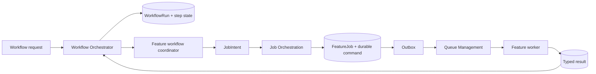
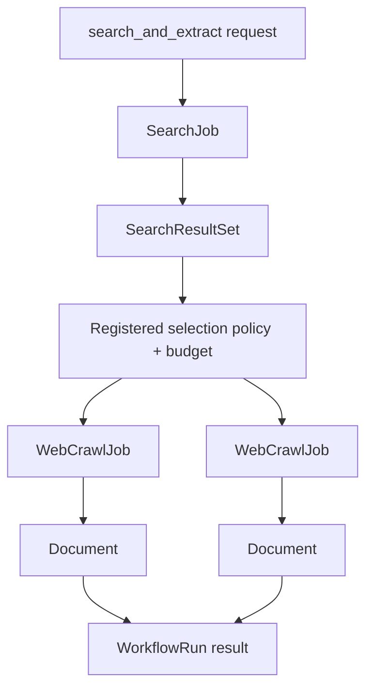

# Request-driven Workflow Orchestration Documentation Design

> **Superseded for curriculum scope:** `docs/learning/` has been restored and aligned by [`2026-11-09-learning-curriculum-design.md`](2026-11-09-learning-curriculum-design.md). This document remains the record of the earlier worker-architecture documentation decision.

## Intent

Document a worker platform that turns one explicit request into a bounded workflow. A workflow may search, crawl, classify, discover media, and create child jobs, but it only runs when requested and always follows registered policy, quota and recipe rules.

## Goals

- Separate workflow planning from job lifecycle and message delivery.
- Let one requested workflow coordinate multiple feature jobs without duplicating job state, retry, lease, cancellation or DLQ logic.
- Document `search`, direct URL crawl, and explicit `search_and_extract` as MVP workflows.
- Describe action/data flows, durable objects and the responsibility of each feature in a way that supports later image, video, browser and multi-depth workflows.
- Provide a versioned roadmap from document MVP to bounded depth 2–3 crawling and scheduled recrawl.

## Non-goals

- No source-code, schema, API, configuration or dependency change.
- No background workflow without an explicit request in MVP.
- No LLM-generated action plan, arbitrary browser selector/JavaScript, automatic login, CAPTCHA/paywall/DRM bypass, or unbounded link following.
- No feature service directly creates, schedules or retries another feature's job.
- No active learning path for the superseded API/RAG architecture; its historical material belongs in `docs/sample/`, not active worker documentation.

## Constraints

- Only add or modify Markdown below `docs/`.
- Queue messages carry only `job_id`, `feature_code`, `contract_version` and `correlation_id`; full commands and workflow state are durable records.
- Network Policy is re-evaluated immediately before each network call and redirect.
- Browser interaction is only a reviewed, versioned, server-side recipe for an approved source.
- Policy, DRM, entitlement, validation and cancellation outcomes are terminal and non-retryable.

## Chosen architecture

The design combines three coordination levels without sharing lifecycle ownership:

| Level | Responsibility | Must not own |
|---|---|---|
| `WorkflowOrchestrator` | creates `WorkflowRun`, chooses registered workflow definition, resolves dependencies, enforces workflow budget/depth, and fans child-job results in/out | queue delivery, lease, retry, or feature business execution |
| `FeatureWorkflowCoordinator` | a feature-owned declarative mapping from workflow step input to a `JobIntent`, and from result to the next permitted step | durable job state, direct queue publish, retries or another feature's implementation |
| `JobOrchestrationService` | one durable `FeatureJob` lifecycle: submission, idempotency, cancellation, status and route | workflow graph, network work or feature business rules |
| `QueueManagementService` | outbox, publish, lease, retry schedule, DLQ and acknowledgement | workflow planning or command interpretation |
| Feature service | validates and executes its typed command, rechecks policy, and commits its typed result | creating another feature's job |

## Request and object model

| Object | Purpose | Key contents |
|---|---|---|
| `WorkflowRequest` | Explicit user/producer intent | request type, URL or query, output goal, requested depth, child-job/item budget, browser permission flag, caller/policy context, idempotency key |
| `WorkflowDefinition` | Registered and versioned allowed path | step graph, allowed feature coordinators, terminal outcomes, budgets and approval/policy requirements |
| `WorkflowRun` | Durable parent execution | request reference, definition version, state, budget use, child-job references, result reference and audit/correlation data |
| `WorkflowStep` | One resolved dependency in a run | input reference, coordinator, state, child `FeatureJob` reference, typed output/error reference |
| `JobIntent` | Feature-neutral hand-off to job lifecycle | feature code, typed command reference, parent run/step reference, idempotency scope and queue route |
| `FeatureJob` | Durable execution unit | feature code, command, status, lease/attempt data, result reference and cancellation state |

## MVP workflows

| Workflow request | MVP action | Output | Boundary |
|---|---|---|---|
| `search` | Submit one `SearchJob`; normalize/deduplicate provider results. | `SearchResultSet` | Does not crawl results. |
| `crawl_url` | Submit one `WebCrawlJob`; static fetch, normalize Markdown and classify document. | `Document` | No child link follow, browser recipe or media job. |
| `search_and_extract` | Submit `SearchJob`; the registered selection rule chooses a bounded subset of normalized results; submit one `WebCrawlJob` per selected result. | `SearchResultSet` plus `Document` references | This fan-out is allowed only because the request explicitly selected this workflow; Search worker itself never creates crawl jobs. |

## Version roadmap

| Version | Scope | Explicit exclusions |
|---|---|---|
| MVP v1 | `search`, `crawl_url`, `search_and_extract`; static content classification for news, technical documentation, learning material and generic pages; bounded child jobs and result aggregation. | Browser actions, media download, recursive links and schedules. |
| v1.1 | `extract_images`: discover approved static image candidates from a requested page and create bounded image child jobs; return partial `ImageManifest`. | Browser lazy-load and automatic page expansion. |
| v1.2 | `extract_video`: approved-source browser recipe may wait/click Play/capture allowed media evidence, then create bounded video jobs. | User-provided selectors/JS, credentials, DRM or access-control bypass. |
| v2 | `crawl_collection`: explicit depth 2–3 content crawl with domain allowlist, canonical/dedupe, link/page/byte/time budgets, loop prevention and aggregate documents. | Deep/unbounded domain crawling. |
| v2.1+ | Registered scheduled recrawl and freshness workflows, each with independent quotas, retention and audit. | Generic cron that executes arbitrary URLs or workflow definitions. |

## Documentation changes

| Path | Change |
|---|---|
| `docs/platform/workflow-orchestration.md` | New canonical request, object, workflow, state and MVP/roadmap contract. |
| `docs/platform/job-orchestration.md` | New single-source `FeatureJob` lifecycle and boundary from workflow to queue. |
| `docs/platform/queue-management.md` | Clarify delivery-only ownership and orchestration hand-offs. |
| `docs/architecture/worker-crawler-rearchitecture.md` | Add the three coordination levels, common flow and canonical names. |
| `docs/features/*.md` | Describe command/job/result objects and each feature's workflow role. |
| `docs/features/web-crawl.md` | Link Document Type Classification as its classification contract. |
| `docs/INDEX.md` | Link the new platform contracts and classification specification. |
| `docs/learning/` | Remove the superseded API/RAG learning path; historical architecture references remain in `docs/sample/`. |

## Acceptance criteria

- Docs explain how an explicit request can create a workflow of child jobs without feature-to-feature calls.
- Every durable object has one owner and Job Orchestration remains the only `FeatureJob` lifecycle owner.
- Search alone never crawls; only explicit `search_and_extract` can fan out to bounded crawl jobs.
- MVP and deferred capabilities make browser/media/depth/scheduling boundaries unambiguous.
- All local Markdown links under `docs/` resolve.
- Active documentation contains only the worker architecture/contracts/runbooks; samples remain clearly isolated as reference material.
